# Hourly direct reinforcement on BTCUSDT: no critic, no sampled advantage

Study window 2021-06-01 inclusive to 2026-06-01 exclusive.  43824 hourly decisions built from 535104 five-minute bars with 31.0 days of feature warm-up, and 5934 funding settlements applied at their exact timestamps.  BTCUSDT USD-M perpetual futures only.

## Protocol

| item | value |
|---|---|
| decision interval hours | 1 |
| observation | 12 five-minute bars x 4 variables + 7 slow variables + 3 causal funding-schedule variables + position one-hot |
| actions | three-way target position, straight-through hard selection |
| exposure | 1x notional |
| reward | realised account return; risk aversion lives in the objective only |
| funding | applied at exact Binance settlement timestamps to the position open before them |
| selection rule | median over folds and seeds of the validation total_log_return |
| maximum updates | 300 |
| evaluation interval | 10 |
| cost arms | {'zero_cost': 0.0, 'economic': 0.0001} |
| realistic cost, for reference only | 0.00039999999999999996 |
| selection seeds | [11, 29, 47, 71, 101] |
| final seeds | [11, 29, 47, 71, 101, 137, 179, 211, 257, 293] |

## Supervised signal check, before any RL

Ridge probe on exactly the agent's state, fitted on each fold's training window and scored on that fold's validation window.  The hurdle is the information coefficient at which a sign-following position pays this study's round trip at that holding
period.  hourly_eq and hourly_v2 scored the same probe against an 8 bp round trip.

| horizon (h) | median IC | break-even IC | folds clearing |
|---|---|---|---|
| 1 | +0.0175 | 0.0457 | 0/4 |
| 3 | +0.0288 | 0.0268 | 2/4 |
| 6 | +0.0421 | 0.0192 | 4/4 |
| 12 | +0.0388 | 0.0136 | 4/4 |
| 24 | +0.0386 | 0.0098 | 3/4 |
| 72 | -0.0005 | 0.0058 | 2/4 |

## Configuration and budget, selected on validation folds only

Rule declared before the search: **median over folds and seeds of the validation total_log_return**.  360 (configuration, budget) cells were scored.

Selected **c04** at **100 updates**, median validation log return +0.3056.

```json
{
  "batch_windows": 16,
  "window_hours": 256,
  "warmup_hours": 64,
  "learning_rate": 0.0003,
  "weight_decay": 0.0,
  "max_gradient_norm": 1.0,
  "temperature": 1.0,
  "exploration": "greedy",
  "exploration_noise": 1.0,
  "soft_positions": false,
  "input_noise": 0.0,
  "head_dropout": 0.0,
  "objective": "sharpe",
  "risk_aversion": 0.02,
  "annualise_sharpe": false,
  "regularisation": "none",
  "position_ladder": "ternary",
  "funding_features": true
}
```

| rank | config | budget | median | IQR |
|---|---|---|---|---|
| 1 | c04 | 100 | +0.3056 | [+0.0165, +0.4395] |
| 2 | c05 | 100 | +0.2978 | [+0.0450, +0.4341] |
| 3 | c05 | 110 | +0.2676 | [+0.0685, +0.4320] |
| 4 | c11 | 110 | +0.2567 | [-0.1229, +0.4587] |
| 5 | c05 | 90 | +0.2517 | [+0.0861, +0.3281] |
| 6 | c05 | 120 | +0.2459 | [-0.0952, +0.4094] |
| 7 | c04 | 80 | +0.2451 | [+0.0665, +0.3942] |
| 8 | c09 | 110 | +0.2316 | [+0.0371, +0.4713] |
| 9 | c04 | 90 | +0.2308 | [+0.0467, +0.4404] |
| 10 | c09 | 100 | +0.2246 | [+0.0430, +0.4501] |

The momentum benchmark's lookback was chosen the same way and on the same folds: **72 hours**.

## Zero-cost diagnostic gate

Criteria: median zero-cost validation log return exceeds zero, exceeds the best simple benchmark, and more than half the runs sit above the 95th percentile of their own matched-turnover circular-shift null.

| quantity | value |
|---|---|
| runs | 40 |
| policy median validation log return | +0.2966 |
| policy IQR | [+0.0975, +0.4777] |
| best benchmark median | +0.3070 |
| runs beating the best benchmark | 55.0% |
| runs above the 95th percentile of their matched-turnover null | 37.5% |
| **gate passed** | **False** |

> The zero-cost policy does not consistently beat matched-turnover noise and the simple rules.  Under the predeclared reading of the protocol that is a **signal** result, not a cost result: the test numbers below should not be read as evidence that fees and funding are what stands in the way.

## Sealed test year, 1 June 2025 to 1 June 2026

Opened once, after every final run reported complete.  Deterministic argmax, frozen weights and frozen normaliser, hidden state warmed causally over the preceding 240 hours.  Median across seeds with the interquartile range in brackets.

| strategy | total return | annualised | Sharpe | Sortino | max drawdown | turnover/h |
|---|---|---|---|---|---|---|
| always_flat (zero_cost) | +0.00% | +0.00% | +0.000 | +0.000 | +0.00% | 0.000 |
| always_long (zero_cost) | -32.00% | -32.00% | -0.936 | -0.911 | -50.84% | 0.000 |
| momentum_72h (zero_cost) | -34.83% | -34.83% | -1.041 | -1.068 | -41.15% | 0.102 |
| always_flat (economic) | +0.00% | +0.00% | +0.000 | +0.000 | +0.00% | 0.000 |
| always_long (economic) | -32.01% | -32.01% | -0.937 | -0.911 | -50.84% | 0.000 |
| momentum_72h (economic) | -40.39% | -40.39% | -1.258 | -1.291 | -42.39% | 0.102 |
| **DDR zero_cost** | +1.38% [-10.29%, +22.61%] | +1.38% [-10.29%, +22.61%] | +0.0369 [-0.2925, +0.5100] | +0.0328 [-0.2527, +0.4832] | -33.95% [-36.24%, -31.28%] | +0.6957 [+0.5380, +0.7279] |
| **DDR economic** | -23.31% [-28.37%, -12.87%] | -23.31% [-28.37%, -12.87%] | -0.6705 [-0.8767, -0.3670] | -0.6546 [-0.8266, -0.3489] | -38.60% [-39.65%, -34.54%] | +0.3680 [+0.3318, +0.4340] |

### Every seed

| arm | seed | total return | Sharpe | max drawdown | turnover/h | long/flat/short | price / funding / cost | null percentile |
|---|---|---|---|---|---|---|---|---|
| zero_cost | 11 | -10.99% | -0.317 | -35.46% | 0.513 | 0.52/0.28/0.20 | -0.0731 / +0.0243 / -0.0000 | 56.0 |
| zero_cost | 29 | -31.75% | -0.987 | -46.34% | 0.710 | 0.52/0.14/0.34 | -0.3397 / +0.0325 / -0.0000 | 26.6 |
| zero_cost | 47 | +27.32% | +0.611 | -32.43% | 0.681 | 0.65/0.07/0.28 | +0.2852 / +0.0344 / -0.0000 | 89.3 |
| zero_cost | 71 | +0.13% | +0.004 | -40.72% | 0.502 | 0.56/0.23/0.21 | +0.0323 / +0.0343 / -0.0000 | 72.9 |
| zero_cost | 101 | +67.14% | +1.342 | -22.65% | 0.775 | 0.53/0.14/0.33 | +0.5519 / +0.0350 / -0.0000 | 95.1 |
| zero_cost | 137 | +40.21% | +0.886 | -30.14% | 0.729 | 0.54/0.18/0.28 | +0.3731 / +0.0376 / -0.0000 | 91.9 |
| zero_cost | 179 | +8.48% | +0.206 | -31.14% | 0.724 | 0.52/0.06/0.41 | +0.1244 / +0.0350 / -0.0000 | 69.5 |
| zero_cost | 211 | -8.19% | -0.220 | -31.71% | 0.731 | 0.56/0.15/0.29 | -0.0440 / +0.0337 / -0.0000 | 59.6 |
| zero_cost | 257 | +2.62% | +0.070 | -36.22% | 0.613 | 0.53/0.21/0.26 | +0.0639 / +0.0300 / -0.0000 | 70.0 |
| zero_cost | 293 | -15.13% | -0.428 | -36.25% | 0.452 | 0.63/0.15/0.21 | -0.1195 / +0.0289 / -0.0000 | 55.4 |
| economic | 11 | -33.51% | -1.106 | -39.64% | 0.369 | 0.51/0.33/0.16 | -0.0324 / +0.0153 / -0.3229 | 60.8 |
| economic | 29 | -55.96% | -2.116 | -64.71% | 0.419 | 0.54/0.19/0.27 | -0.4026 / +0.0244 / -0.3667 | 19.5 |
| economic | 47 | +3.13% | +0.077 | -28.27% | 0.367 | 0.74/0.06/0.20 | +0.4080 / +0.0258 / -0.3219 | 96.5 |
| economic | 71 | -10.08% | -0.280 | -36.03% | 0.317 | 0.67/0.17/0.16 | +0.2235 / +0.0201 / -0.2779 | 90.1 |
| economic | 101 | -5.72% | -0.156 | -30.51% | 0.344 | 0.53/0.23/0.24 | +0.2868 / +0.0274 / -0.3015 | 88.2 |
| economic | 137 | -21.24% | -0.628 | -39.41% | 0.441 | 0.59/0.24/0.18 | +0.1903 / +0.0291 / -0.3859 | 85.7 |
| economic | 179 | -24.03% | -0.690 | -39.65% | 0.453 | 0.52/0.08/0.40 | +0.1727 / +0.0285 / -0.3967 | 73.5 |
| economic | 211 | -22.59% | -0.651 | -34.05% | 0.439 | 0.61/0.15/0.24 | +0.1795 / +0.0265 / -0.3847 | 81.5 |
| economic | 257 | -29.23% | -0.918 | -37.80% | 0.328 | 0.55/0.23/0.23 | -0.0081 / +0.0204 / -0.2871 | 65.1 |
| economic | 293 | -25.81% | -0.753 | -42.78% | 0.292 | 0.71/0.12/0.17 | +0.0164 / +0.0192 / -0.2555 | 74.7 |

### Round trips, economic arm

A round trip is a maximal run of one held position; flat stretches are not trades.  Profit factor is gross winnings over gross losses, so 1.00 is break-even.  ``gross`` and ``cost`` are per trade, and their difference is what the trade actually returned.

| seed | trades | median hours | share >= 6 h | win rate | profit factor | gross/trade | cost/trade | net/trade |
|---|---|---|---|---|---|---|---|---|
| 11 | 1615 | 2 | 13.4% | 51.0% | 0.932 | -0.00002 | 0.00016 | -0.00018 |
| 29 | 1834 | 2 | 15.2% | 51.5% | 0.861 | -0.00021 | 0.00016 | -0.00037 |
| 47 | 1610 | 2 | 22.9% | 51.2% | 1.032 | +0.00026 | 0.00018 | +0.00009 |
| 71 | 1390 | 2 | 20.3% | 54.5% | 1.001 | +0.00016 | 0.00016 | +0.00000 |
| 101 | 1508 | 2 | 18.3% | 52.7% | 1.012 | +0.00020 | 0.00017 | +0.00003 |
| 137 | 1930 | 2 | 14.3% | 53.0% | 0.981 | +0.00010 | 0.00015 | -0.00004 |
| 179 | 1984 | 2 | 16.8% | 52.1% | 0.965 | +0.00009 | 0.00018 | -0.00009 |
| 211 | 1924 | 2 | 14.9% | 50.9% | 0.971 | +0.00010 | 0.00017 | -0.00007 |
| 257 | 1436 | 2 | 22.1% | 52.4% | 0.947 | -0.00000 | 0.00015 | -0.00016 |
| 293 | 1278 | 2 | 22.6% | 51.6% | 0.946 | +0.00001 | 0.00016 | -0.00015 |
| **median** | 1612 | 2 | 17.6% | 51.8% | 0.968 | +0.00010 | 0.00016 | -0.00008 |

### Round trips, zero cost arm

A round trip is a maximal run of one held position; flat stretches are not trades.  Profit factor is gross winnings over gross losses, so 1.00 is break-even.  ``gross`` and ``cost`` are per trade, and their difference is what the trade actually returned.

| seed | trades | median hours | share >= 6 h | win rate | profit factor | gross/trade | cost/trade | net/trade |
|---|---|---|---|---|---|---|---|---|
| 11 | 2247 | 1 | 9.2% | 51.9% | 0.986 | -0.00003 | 0.00000 | -0.00003 |
| 29 | 3110 | 1 | 7.1% | 52.2% | 0.948 | -0.00011 | 0.00000 | -0.00011 |
| 47 | 2985 | 2 | 10.0% | 54.1% | 1.050 | +0.00010 | 0.00000 | +0.00010 |
| 71 | 2200 | 2 | 11.2% | 54.6% | 1.008 | +0.00002 | 0.00000 | +0.00002 |
| 101 | 3393 | 1 | 5.9% | 52.6% | 1.089 | +0.00017 | 0.00000 | +0.00017 |
| 137 | 3194 | 1 | 6.4% | 52.0% | 1.065 | +0.00012 | 0.00000 | +0.00012 |
| 179 | 3173 | 2 | 8.0% | 52.9% | 1.022 | +0.00004 | 0.00000 | +0.00004 |
| 211 | 3201 | 1 | 6.6% | 51.6% | 0.995 | -0.00001 | 0.00000 | -0.00001 |
| 257 | 2686 | 1 | 10.2% | 52.8% | 1.012 | +0.00003 | 0.00000 | +0.00003 |
| 293 | 1980 | 2 | 13.4% | 52.8% | 0.974 | -0.00006 | 0.00000 | -0.00006 |
| **median** | 3048 | 1 | 8.6% | 52.7% | 1.010 | +0.00002 | 0.00000 | +0.00002 |

### The same policies at the realistic cost

The rows below take each finished action path above, change nothing about it, and re-price it at the realistic 4 bp one way that hourly_eq and hourly_v2 were charged.  When the traded arm is already at that rate the two columns agree and the table is a consistency check; when it is not, the gap is exactly what the cheaper assumption is worth.

| arm | median return as traded | median return at 4 bp | median Sharpe at 4 bp | seeds positive at 4 bp |
|---|---|---|---|---|
| zero_cost | +1.38% | -88.62% | -5.730 | 0 of 10 |
| economic | -23.31% | -72.44% | -3.390 | 0 of 10 |

### Matched-turnover null

The null rotates each policy's own action sequence against history, which preserves every holding length and the exact turnover while destroying alignment with the returns those actions were chosen for.  A percentile above 95 means the policy beat its own turnover-matched noise.

| arm | median percentile | seeds above 95 |
|---|---|---|
| zero_cost | 69.8 | 1 of 10 |
| economic | 78.1 | 1 of 10 |

### Post-hoc regimes

Regimes are assigned after the fact from the trailing 30-day return and are never in the state; the GRU is left to infer conditions from returns, momentum, volatility and order flow.

| arm | regime | hours | median total log return | long/flat/short |
|---|---|---|---|---|
| zero_cost | bull | 986 | -0.0503 | 0.59/0.16/0.23 |
| zero_cost | bear | 1688 | -0.0600 | 0.61/0.12/0.24 |
| zero_cost | chop | 6086 | +0.2118 | 0.51/0.16/0.29 |
| economic | bull | 986 | -0.1027 | 0.57/0.25/0.14 |
| economic | bear | 1688 | -0.1023 | 0.72/0.06/0.19 |
| economic | chop | 6086 | -0.0491 | 0.53/0.19/0.22 |

## Trading charts

What the strategy did with money, drawn from the hour-by-hour sealed-test trajectories rather than from any model.  The first chart is the one this project turns on: the distance between the direction P&L and the net line is the transaction cost, and in every study so far it has been the larger number.

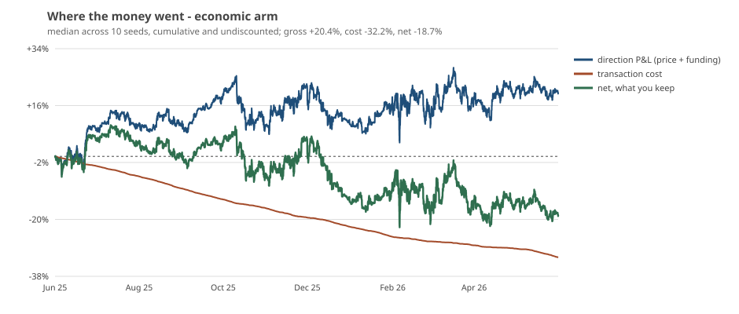

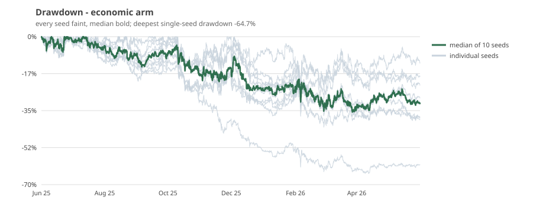

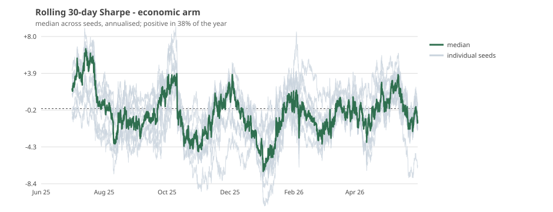

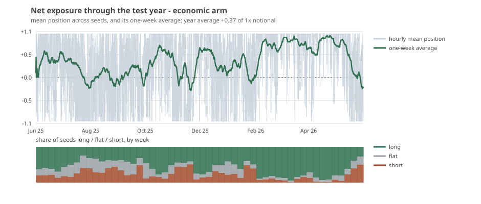

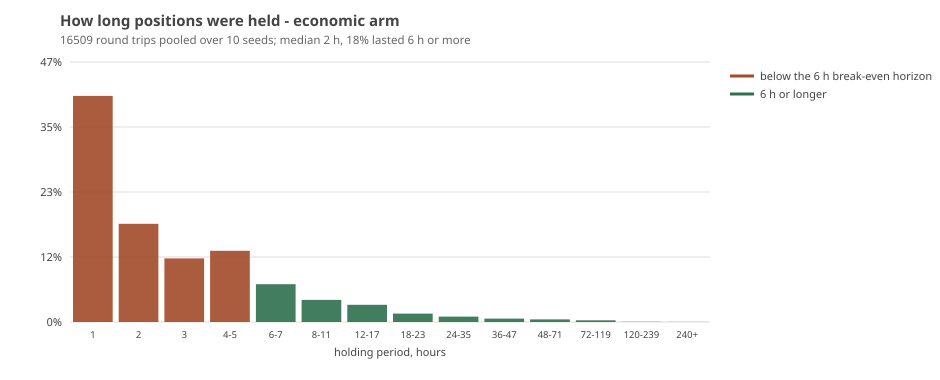

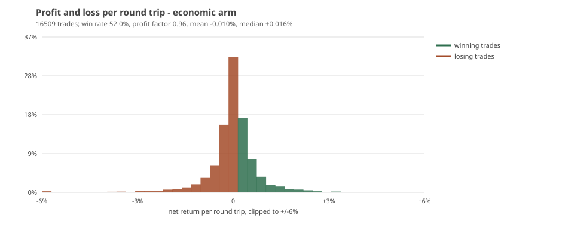

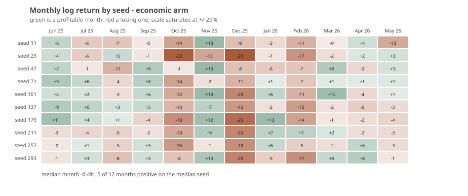

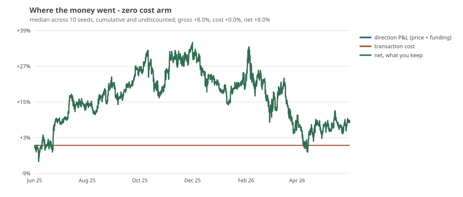

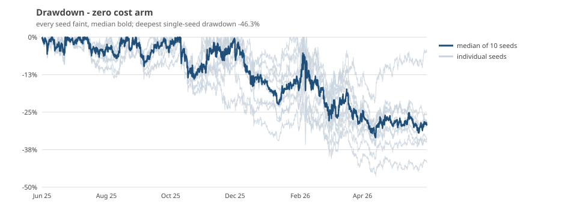

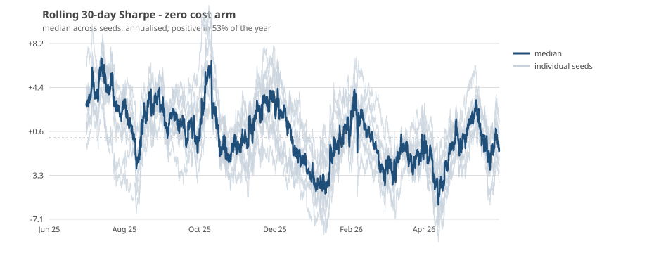

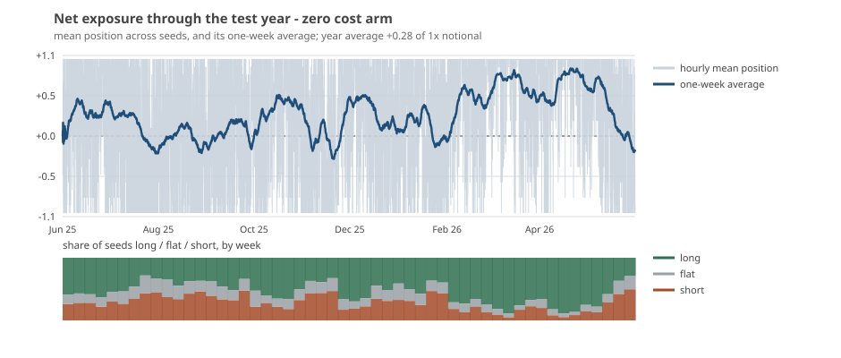

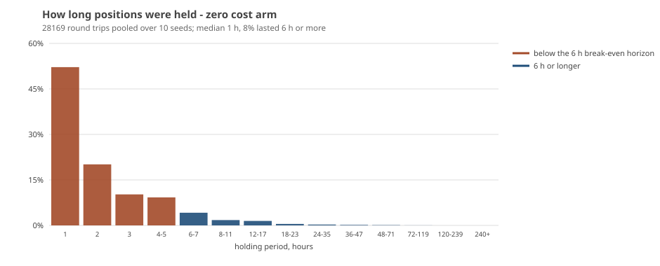

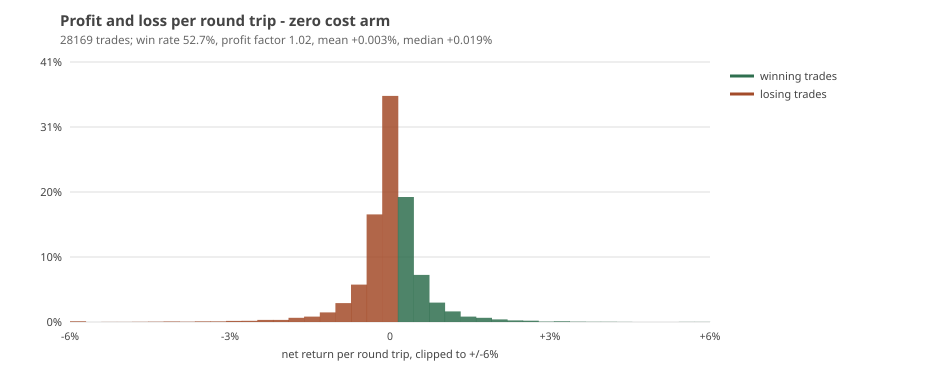

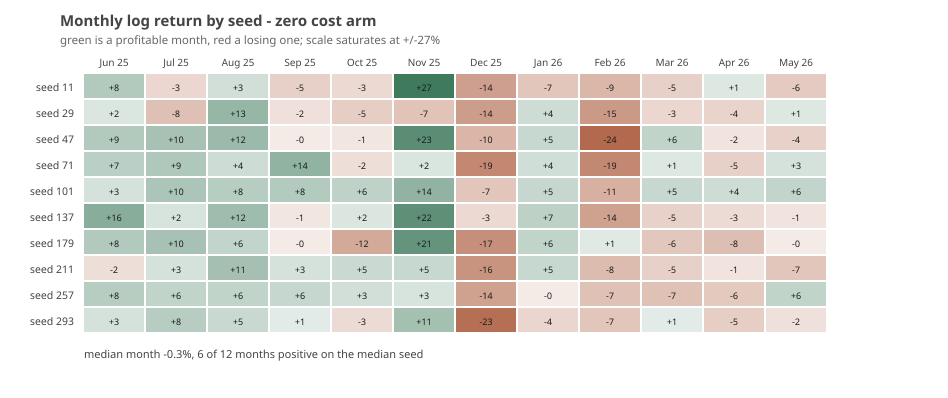

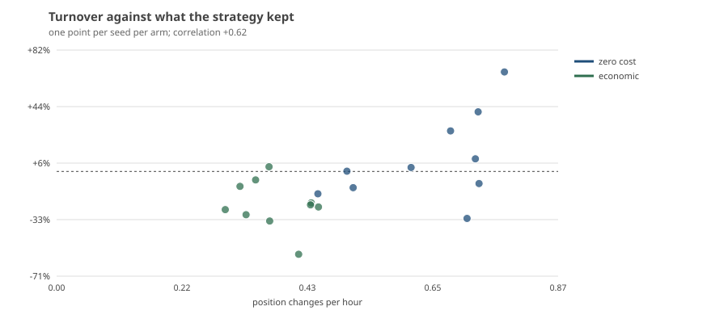

## Training and protocol charts

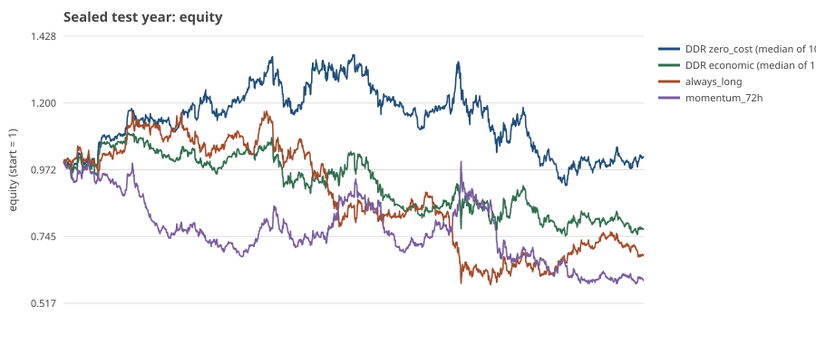

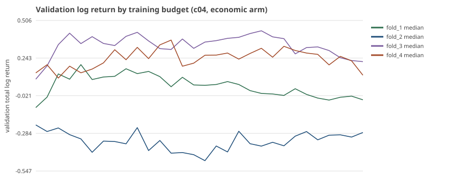

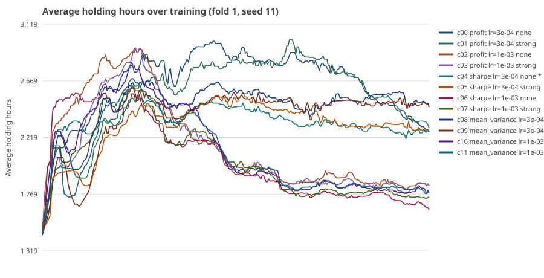

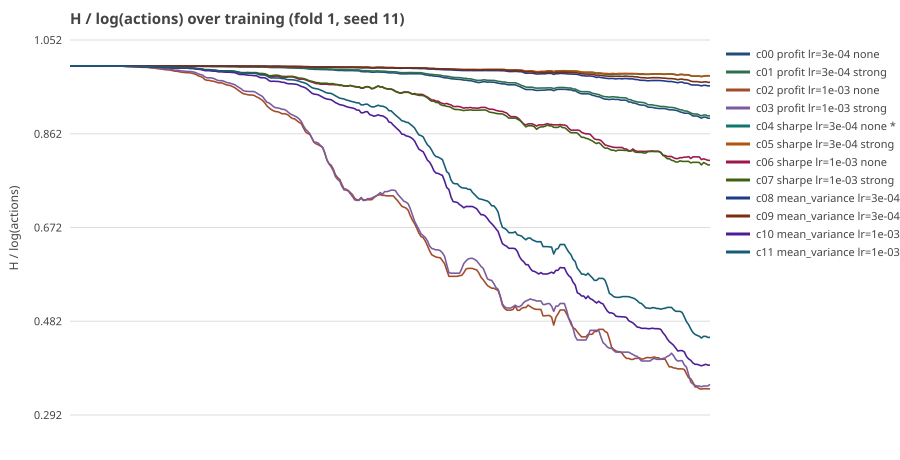

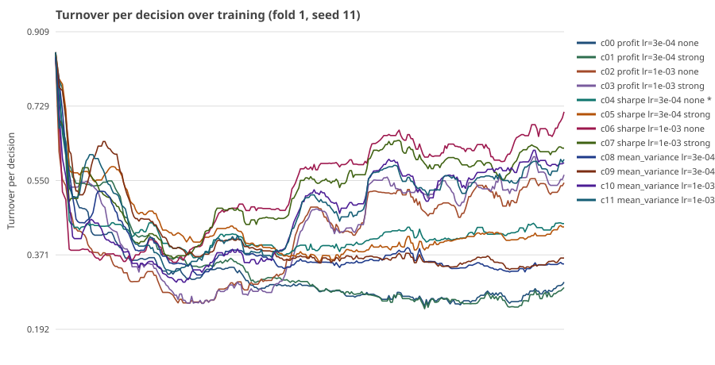

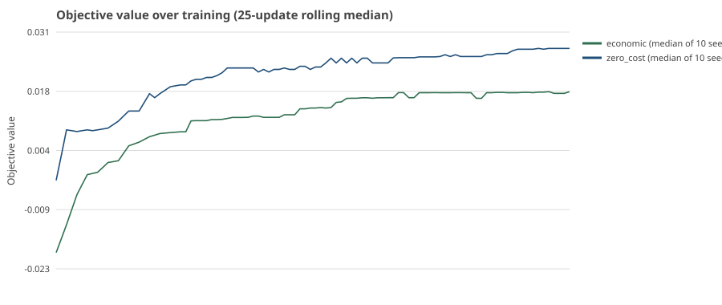

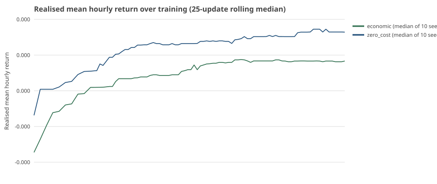

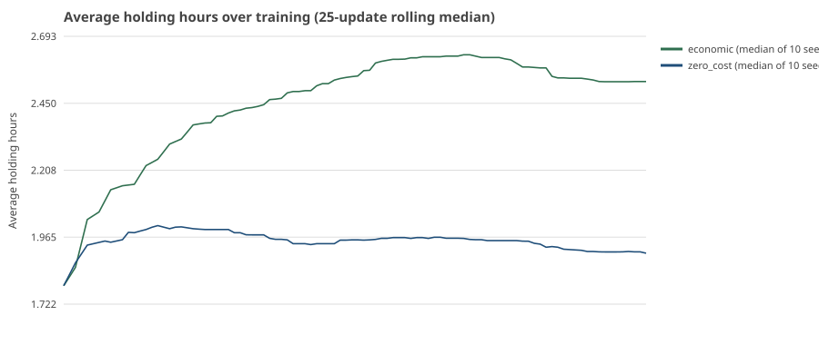

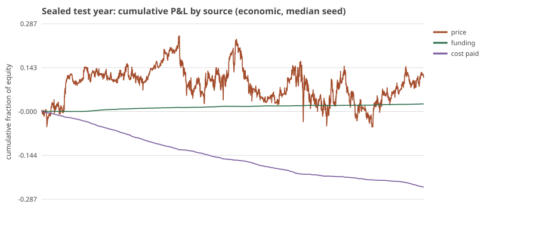

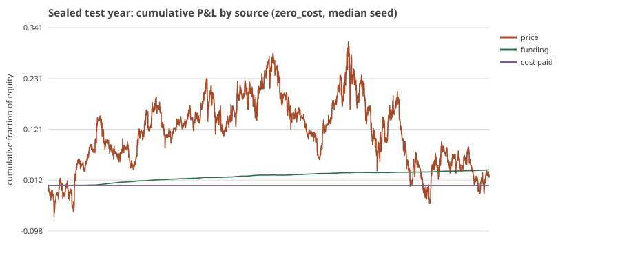

## Files

| file | what it holds |
|---|---|
| `experiment.json` | protocol, dataset audit, stage progress, selection, gate |
| `selection.json` | the configuration and budget chosen on the folds |
| `zero_cost_gate.json` | the diagnostic gate, run before the test was opened |
| `test_results.json` | every seed, benchmark, null and breakdown on the test year |
| `test_seed_table.csv` | the per-seed table above, machine readable |
| `test_trajectories/` | hourly position, P&L decomposition and equity per seed |
| `<split>/<arm>/<config>/seed_<n>/updates.jsonl` | one line per direct-reinforcement update |
| `<split>/<arm>/<config>/seed_<n>/training.json` | the validation curve for that run |
