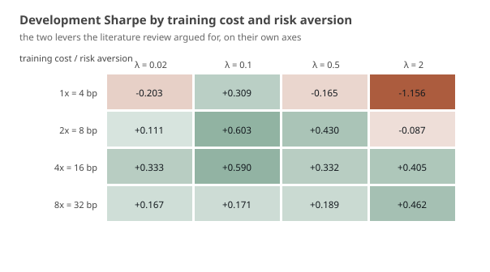

# Walk-forward direct reinforcement on BTCUSDT, 1h clock

Every block below is traded out of sample: the weights that traded it were fitted only on data preceding it, then the window rolls forward and training continues.  There is no frozen model held across a whole year, which is the practice every successful system in the literature review follows and none of the earlier studies here did.

## Protocol

| item | value |
|---|---|
| decision interval hours | 1 |
| objective | mean_variance |
| selection rule | median over seeds of development sharpe at 4 bp |
| trailing training window | 26 weeks |
| retrain and trade block | 4 weeks |
| burn-in updates | 150 |
| updates per retrain | 25 |
| reported cost, one way | 0.00039999999999999996 |
| training cost multipliers searched | [1.0, 2.0, 4.0, 8.0] |
| risk aversions searched | [0.02, 0.1, 0.5, 2.0] |
| development window | 2022-01-01 00:00:00+00:00 to 2024-06-01 00:00:00+00:00 |
| sealed window | 2024-06-01 00:00:00+00:00 to 2026-06-01 00:00:00+00:00 |
| development seeds | [11, 29, 47, 71, 101] |
| sealed seeds | [11, 29, 47, 71, 101, 137, 179, 211, 257, 293] |
| numpy/torch accounting difference | 0.0 |

## Supervised break-even hurdle

A ridge probe on exactly the agent's state, fitted on the first 60% of decisions and scored on the rest.  The hurdle is the information coefficient at which a sign-following position pays its own 8 bp round trip at that horizon.

| horizon (h) | realised IC | break-even IC | clears |
|---|---|---|---|
| 1 | +0.0238 | 0.2021 | no |
| 3 | +0.0119 | 0.1175 | no |
| 6 | +0.0144 | 0.0833 | no |
| 12 | +0.0147 | 0.0593 | no |
| 24 | +0.0212 | 0.0425 | no |
| 72 | -0.0330 | 0.0253 | no |

## Configuration, selected on development data only

Selected **c05**: training cost **2x** the real rate (8 bp), risk aversion **0.1**.  Median development Sharpe +0.6034.

| rank | config | cost | lambda | median dev Sharpe | per seed |
|---|---|---|---|---|---|
| 1 | c05 | 2x | 0.1 | +0.6034 | +0.578, +0.668, +0.603, +0.515, +0.694 |
| 2 | c09 | 4x | 0.1 | +0.5905 | +0.619, +0.590, +0.517, +0.475, +0.608 |
| 3 | c15 | 8x | 2 | +0.4618 | +0.492, +0.462, +0.532, +0.324, +0.389 |
| 4 | c06 | 2x | 0.5 | +0.4295 | +0.430, +0.293, +0.375, +0.457, +0.553 |
| 5 | c11 | 4x | 2 | +0.4053 | +0.405, +0.211, +0.449, +0.419, +0.302 |
| 6 | c08 | 4x | 0.02 | +0.3334 | +0.278, +0.333, +0.518, +0.294, +0.394 |
| 7 | c10 | 4x | 0.5 | +0.3317 | +0.332, +0.227, +0.422, +0.432, +0.292 |
| 8 | c01 | 1x | 0.1 | +0.3088 | +0.370, +0.106, +0.255, +0.309, +0.475 |
| 9 | c14 | 8x | 0.5 | +0.1894 | +0.187, +0.279, +0.313, +0.111, +0.189 |
| 10 | c13 | 8x | 0.1 | +0.1710 | +0.035, +0.171, +0.190, +0.222, +0.042 |
| 11 | c12 | 8x | 0.02 | +0.1668 | +0.069, +0.167, +0.211, +0.223, +0.067 |
| 12 | c04 | 2x | 0.02 | +0.1111 | +0.111, +0.170, +0.143, +0.037, +0.106 |
| 13 | c07 | 2x | 2 | -0.0872 | -0.062, -0.527, +0.087, -0.198, -0.087 |
| 14 | c02 | 1x | 0.5 | -0.1650 | -0.400, -0.165, -0.318, -0.120, +0.013 |
| 15 | c00 | 1x | 0.02 | -0.2028 | -0.259, -0.203, -0.170, -0.111, -0.271 |
| 16 | c03 | 1x | 2 | -1.1564 | -1.156, -1.651, -0.975, -1.318, -0.814 |

## Sealed walk-forward evaluation

10 seeds over 2024-06-01 to 2026-06-01, priced at 4 bp one way.  **0 of 10 seeds positive.**

| quantity | median across seeds |
|---|---|
| total return | -11.45% |
| sharpe | -1.199 |
| sortino | -1.416 |
| max drawdown | -14.58% |
| turnover per step | 0.0152 |
| average holding steps | 25.7 |
| mean absolute position | 0.104 |
| hit rate | 0.4834 |
| price pnl | -1.67% |
| funding pnl | -0.20% |
| cost pnl | -10.64% |
| matched-turnover null percentile | 43.0 |
| seeds above the 95th percentile | 0 of 10 |

### Every seed

| seed | total return | Sharpe | max drawdown | turnover/step | holding steps | mean abs position | price / funding / cost | null pct |
|---|---|---|---|---|---|---|---|---|
| 11 | -12.29% | -1.223 | -16.16% | 0.0161 | 24.9 | 0.108 | -1.35% / -0.18% / -11.31% | 43.0 |
| 29 | -9.58% | -0.976 | -12.69% | 0.0149 | 23.2 | 0.099 | +0.78% / -0.15% / -10.45% | 52.5 |
| 47 | -10.11% | -1.047 | -12.86% | 0.0158 | 23.7 | 0.101 | +0.92% / -0.23% / -11.10% | 50.5 |
| 71 | -13.75% | -1.354 | -15.84% | 0.0157 | 25.3 | 0.113 | -3.26% / -0.25% / -11.00% | 34.8 |
| 101 | -11.97% | -1.301 | -14.50% | 0.0147 | 26.0 | 0.100 | -1.99% / -0.22% / -10.30% | 37.8 |
| 137 | -9.04% | -0.834 | -13.43% | 0.0139 | 29.5 | 0.113 | +0.85% / -0.26% / -9.77% | 50.0 |
| 179 | -12.18% | -1.176 | -15.98% | 0.0146 | 29.4 | 0.110 | -2.16% / -0.29% / -10.23% | 43.0 |
| 211 | -12.50% | -1.235 | -14.79% | 0.0155 | 23.8 | 0.107 | -2.13% / -0.11% / -10.83% | 37.5 |
| 257 | -10.89% | -1.167 | -14.66% | 0.0158 | 26.1 | 0.099 | -0.11% / -0.13% / -11.05% | 44.0 |
| 293 | -10.93% | -1.346 | -13.24% | 0.0127 | 26.7 | 0.086 | -2.31% / -0.17% / -8.91% | 38.5 |

### Benchmarks over the same window

| strategy | total return | Sharpe | max drawdown | turnover/step |
|---|---|---|---|---|
| always_flat | +0.00% | +0.000 | +0.00% | 0.0000 |
| always_long | -1.80% | +0.213 | -50.84% | 0.0001 |
| carry | -18.27% | +0.016 | -63.32% | 0.0407 |
| momentum_24h | -84.74% | -1.785 | -86.81% | 0.1957 |
| momentum_72h | -64.45% | -0.878 | -72.69% | 0.1009 |
| momentum_168h | -55.30% | -0.632 | -73.70% | 0.0732 |

## Charts

## Files

| file | what it holds |
|---|---|
| `experiment.json` | protocol, dataset audit, grid, selection, sealed summary |
| `development/` | one JSON per development run |
| `sealed/` | one JSON per sealed run, with its matched-turnover null |
| `sealed_positions/` | the position path each sealed seed traded |