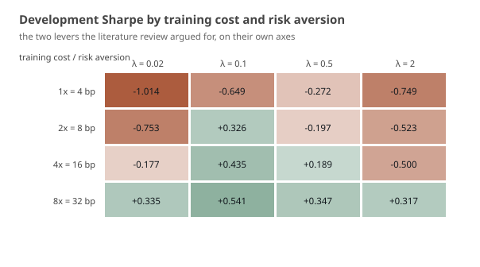
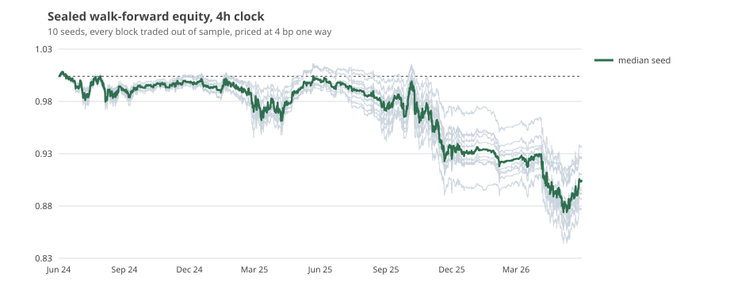

# Walk-forward direct reinforcement on BTCUSDT, 4h clock

Every block below is traded out of sample: the weights that traded it were fitted only on data preceding it, then the window rolls forward and training continues.  There is no frozen model held across a whole year, which is the practice every successful system in the literature review follows and none of the earlier studies here did.

## Protocol

| item | value |
|---|---|
| decision interval hours | 4 |
| objective | mean_variance |
| selection rule | median over seeds of development sharpe at 4 bp |
| trailing training window | 26 weeks |
| retrain and trade block | 4 weeks |
| burn-in updates | 150 |
| updates per retrain | 25 |
| reported cost, one way | 0.00039999999999999996 |
| training cost multipliers searched | [1.0, 2.0, 4.0, 8.0] |
| risk aversions searched | [0.02, 0.1, 0.5, 2.0] |
| development window | 2022-01-01 00:00:00+00:00 to 2024-06-01 00:00:00+00:00 |
| sealed window | 2024-06-01 00:00:00+00:00 to 2026-06-01 00:00:00+00:00 |
| development seeds | [11, 29, 47, 71, 101] |
| sealed seeds | [11, 29, 47, 71, 101, 137, 179, 211, 257, 293] |
| numpy/torch accounting difference | 0.0 |

## Supervised break-even hurdle

A ridge probe on exactly the agent's state, fitted on the first 60% of decisions and scored on the rest.  The hurdle is the information coefficient at which a sign-following position pays its own 8 bp round trip at that horizon.

| horizon (h) | realised IC | break-even IC | clears |
|---|---|---|---|
| 1 | -0.0115 | 0.1020 | no |
| 3 | -0.0115 | 0.1020 | no |
| 6 | -0.0115 | 0.1020 | no |
| 12 | -0.0012 | 0.0594 | no |
| 24 | -0.0026 | 0.0425 | no |
| 72 | -0.0053 | 0.0253 | no |

## Configuration, selected on development data only

Selected **c13**: training cost **8x** the real rate (32 bp), risk aversion **0.1**.  Median development Sharpe +0.5407.

| rank | config | cost | lambda | median dev Sharpe | per seed |
|---|---|---|---|---|---|
| 1 | c13 | 8x | 0.1 | +0.5407 | +0.488, +0.516, +0.623, +0.541, +0.597 |
| 2 | c09 | 4x | 0.1 | +0.4348 | +0.435, +0.960, +0.013, +0.094, +0.491 |
| 3 | c14 | 8x | 0.5 | +0.3471 | +0.347, +0.286, +0.194, +0.431, +0.363 |
| 4 | c12 | 8x | 0.02 | +0.3347 | +0.365, +0.254, +0.325, +0.335, +0.336 |
| 5 | c05 | 2x | 0.1 | +0.3260 | -0.004, +0.326, +0.618, +0.679, +0.166 |
| 6 | c15 | 8x | 2 | +0.3174 | +0.317, +0.323, +0.208, +0.333, +0.286 |
| 7 | c10 | 4x | 0.5 | +0.1886 | +0.307, +0.399, -0.072, +0.146, +0.189 |
| 8 | c08 | 4x | 0.02 | -0.1771 | -0.177, -0.049, -0.971, -0.272, +0.016 |
| 9 | c06 | 2x | 0.5 | -0.1966 | +0.166, +0.090, -0.238, -0.197, -0.221 |
| 10 | c02 | 1x | 0.5 | -0.2717 | -0.793, -0.194, -0.397, -0.272, -0.149 |
| 11 | c11 | 4x | 2 | -0.5000 | +0.046, -0.500, -0.717, +0.106, -0.526 |
| 12 | c07 | 2x | 2 | -0.5230 | -0.266, -1.006, -0.553, -0.227, -0.523 |
| 13 | c01 | 1x | 0.1 | -0.6492 | -0.916, +0.249, -1.260, +0.793, -0.649 |
| 14 | c03 | 1x | 2 | -0.7486 | -0.551, -0.749, -1.039, -0.867, -0.350 |
| 15 | c04 | 2x | 0.02 | -0.7530 | -0.855, -0.753, -0.339, +0.615, -1.129 |
| 16 | c00 | 1x | 0.02 | -1.0141 | -0.708, -1.014, -0.981, -1.149, -1.505 |

## Sealed walk-forward evaluation

10 seeds over 2024-06-01 to 2026-06-01, priced at 4 bp one way.  **0 of 10 seeds positive.**

| quantity | median across seeds |
|---|---|
| total return | -9.64% |
| sharpe | -0.913 |
| sortino | -1.033 |
| max drawdown | -13.29% |
| turnover per step | 0.0133 |
| average holding steps | 25.6 |
| mean absolute position | 0.109 |
| hit rate | 0.4957 |
| price pnl | -6.53% |
| funding pnl | -0.71% |
| cost pnl | -2.33% |
| matched-turnover null percentile | 17.2 |
| seeds above the 95th percentile | 0 of 10 |

### Every seed

| seed | total return | Sharpe | max drawdown | turnover/step | holding steps | mean abs position | price / funding / cost | null pct |
|---|---|---|---|---|---|---|---|---|
| 11 | -11.26% | -0.951 | -14.53% | 0.0158 | 24.1 | 0.119 | -8.08% / -0.73% / -2.77% | 17.0 |
| 29 | -9.01% | -0.846 | -13.07% | 0.0131 | 30.0 | 0.108 | -6.14% / -0.71% / -2.30% | 17.2 |
| 47 | -10.27% | -0.954 | -13.50% | 0.0165 | 23.5 | 0.110 | -6.92% / -0.72% / -2.89% | 17.2 |
| 71 | -10.78% | -0.922 | -14.68% | 0.0150 | 22.6 | 0.117 | -7.78% / -0.64% / -2.63% | 19.0 |
| 101 | -10.46% | -0.924 | -13.89% | 0.0134 | 23.8 | 0.113 | -7.57% / -0.79% / -2.35% | 15.8 |
| 137 | -12.24% | -0.941 | -15.78% | 0.0169 | 25.2 | 0.134 | -8.87% / -0.77% / -2.96% | 14.5 |
| 179 | -7.43% | -0.802 | -11.15% | 0.0111 | 30.4 | 0.093 | -4.88% / -0.67% / -1.95% | 19.8 |
| 211 | -7.55% | -0.870 | -9.15% | 0.0104 | 26.1 | 0.085 | -5.12% / -0.70% / -1.83% | 13.5 |
| 257 | -6.45% | -0.799 | -10.44% | 0.0082 | 32.2 | 0.077 | -4.58% / -0.49% / -1.44% | 20.0 |
| 293 | -7.50% | -0.904 | -10.48% | 0.0094 | 27.4 | 0.083 | -5.42% / -0.55% / -1.65% | 19.8 |

### Benchmarks over the same window

| strategy | total return | Sharpe | max drawdown | turnover/step |
|---|---|---|---|---|
| always_flat | +0.00% | +0.000 | +0.00% | 0.0000 |
| always_long | -1.80% | +0.211 | -50.59% | 0.0002 |
| carry | +11.38% | +0.347 | -48.40% | 0.1628 |
| momentum_24h | -64.46% | -0.892 | -74.74% | 0.3811 |
| momentum_72h | -63.52% | -0.863 | -71.92% | 0.2217 |
| momentum_168h | -19.38% | -0.003 | -58.47% | 0.1445 |

## Charts

## Files

| file | what it holds |
|---|---|
| `experiment.json` | protocol, dataset audit, grid, selection, sealed summary |
| `development/` | one JSON per development run |
| `sealed/` | one JSON per sealed run, with its matched-turnover null |
| `sealed_positions/` | the position path each sealed seed traded |