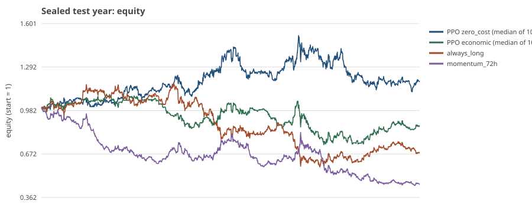
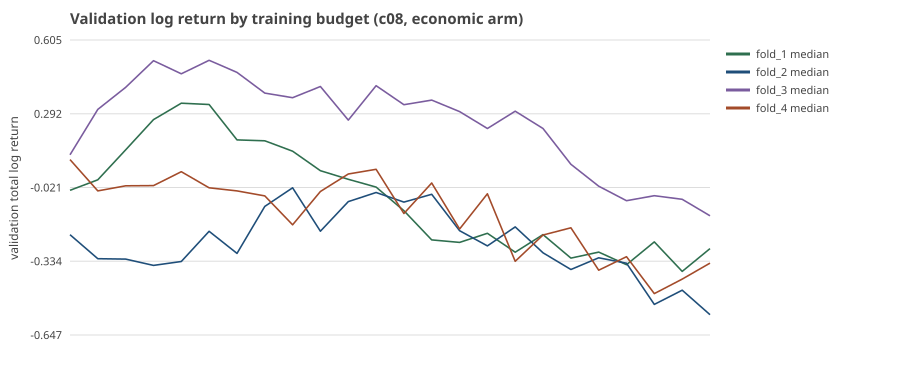
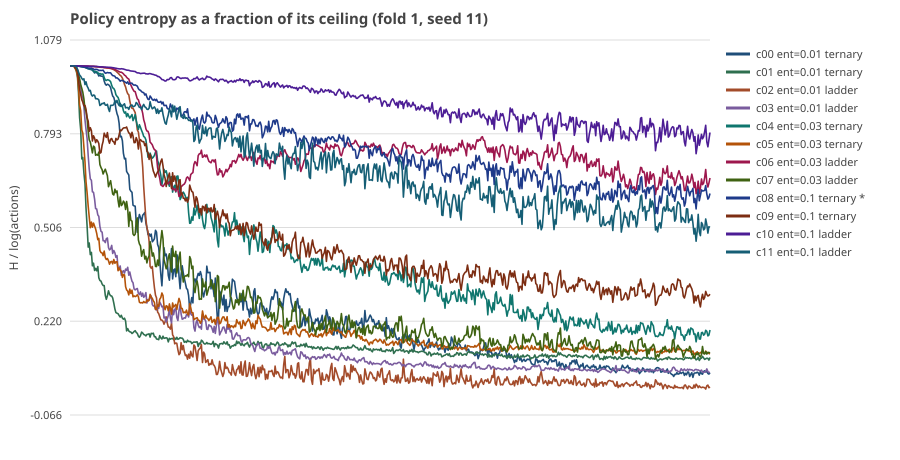
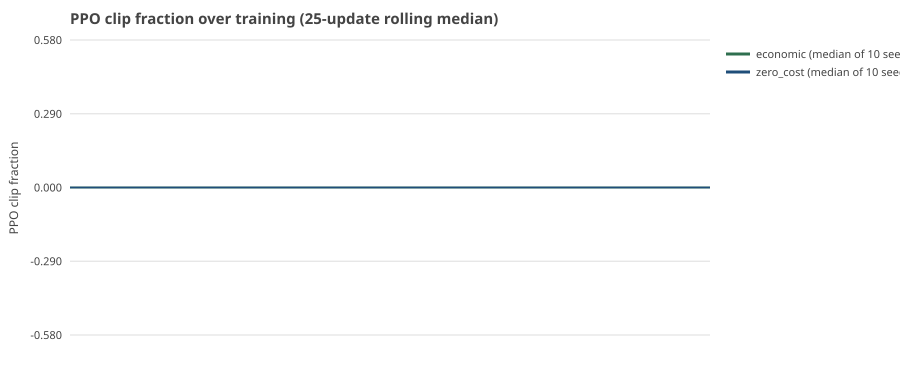
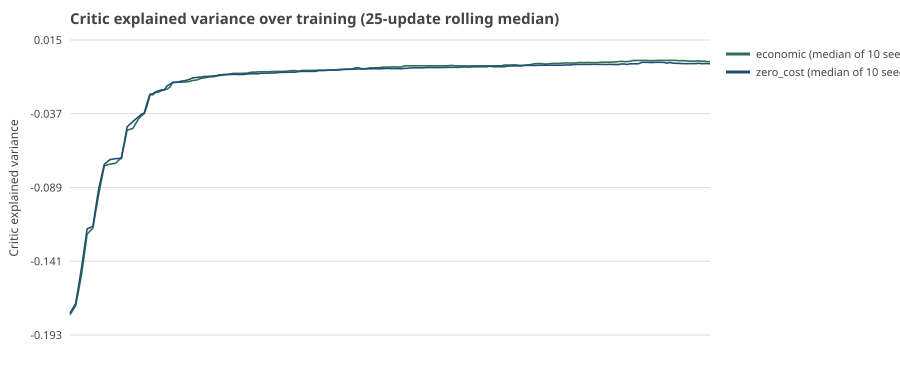
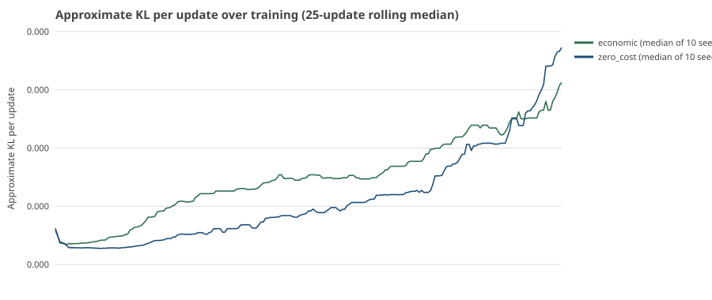

# Hourly GRU-PPO on BTCUSDT, five-minute state, log-equity reward

Study window 2021-06-01 inclusive to 2026-06-01 exclusive.  43824 hourly decisions built from 535104 five-minute bars with 31.0 days of feature warm-up, and 5934 funding settlements applied at their exact timestamps.  BTCUSDT USD-M perpetual futures only.

## Protocol

| item | value |
|---|---|
| decision interval hours | 1 |
| observation | 12 five-minute bars x 4 variables + 7 slow variables + 3 causal funding-schedule variables + position one-hot |
| actions | three-way or seven-level ladder, chosen on validation |
| exposure | 1x notional at the ladder's extremes |
| reward | log change in realised portfolio equity, constant multiplier only |
| funding | applied at exact Binance settlement timestamps to the position open before them |
| selection rule | median over folds and seeds of the validation total_log_return |
| maximum updates | 600 |
| evaluation interval | 25 |
| cost arms | {'zero_cost': 0.0, 'economic': 0.00039999999999999996} |
| selection seeds | [11, 29, 47, 71, 101] |
| final seeds | [11, 29, 47, 71, 101, 137, 179, 211, 257, 293] |

## Supervised signal check, before any RL

Ridge probe on exactly the agent's state, fitted on each fold's training window and scored on that fold's validation window.  The hurdle is the information coefficient at which a sign-following position pays the 8 bp round trip at that holding period.

| horizon (h) | median IC | break-even IC | folds clearing |
|---|---|---|---|
| 1 | +0.0175 | 0.1828 | 0/4 |
| 3 | +0.0288 | 0.1071 | 0/4 |
| 6 | +0.0421 | 0.0766 | 0/4 |
| 12 | +0.0388 | 0.0543 | 1/4 |
| 24 | +0.0386 | 0.0391 | 2/4 |
| 72 | -0.0005 | 0.0233 | 2/4 |

## Configuration and budget, selected on validation folds only

Rule declared before the search: **median over folds and seeds of the validation total_log_return**.  243 (configuration, budget) cells were scored.

Selected **c08** at **225 updates**, median validation log return +0.1841.

```json
{
  "environments": 32,
  "rollout_steps": 128,
  "minibatches": 2,
  "epochs": 4,
  "gamma": 0.5,
  "gae_lambda": 0.5,
  "clip_range": 0.2,
  "value_clip_range": null,
  "value_coefficient": 0.5,
  "entropy_coefficient": 0.1,
  "learning_rate": 0.0003,
  "max_gradient_norm": 0.5,
  "normalise_advantages": true,
  "normalise_returns": true,
  "adaptive_learning_rate": false,
  "target_kl": 0.02,
  "learning_rate_minimum": 1e-05,
  "learning_rate_maximum": 0.03,
  "learning_rate_factor": 1.5,
  "critic_learning_rate_multiplier": 1.0,
  "position_ladder": "ternary",
  "funding_features": true
}
```

| rank | config | budget | median | IQR |
|---|---|---|---|---|
| 1 | c08 | 225 | +0.1841 | [-0.0328, +0.2828] |
| 2 | c08 | 150 | +0.1674 | [-0.1556, +0.4372] |
| 3 | c08 | 100 | +0.1483 | [-0.0689, +0.3585] |
| 4 | c08 | 75 | +0.1412 | [-0.2369, +0.3704] |
| 5 | c04 | 250 | +0.1324 | [+0.0164, +0.2923] |
| 6 | c08 | 125 | +0.1286 | [-0.1436, +0.3909] |
| 7 | c08 | 250 | +0.1027 | [-0.1299, +0.3503] |
| 8 | c08 | 200 | +0.1010 | [-0.0378, +0.3421] |
| 9 | c04 | 225 | +0.0918 | [-0.0347, +0.2625] |
| 10 | c08 | 175 | +0.0764 | [-0.1493, +0.2462] |

The momentum benchmark's lookback was chosen the same way and on the same folds: **72 hours**.

## Zero-cost diagnostic gate

Criteria: median zero-cost validation log return exceeds zero, exceeds the best simple benchmark, and more than half the runs sit above the 95th percentile of their own matched-turnover circular-shift null.

| quantity | value |
|---|---|
| runs | 40 |
| policy median validation log return | +0.2418 |
| policy IQR | [+0.1247, +0.3967] |
| best benchmark median | +0.3070 |
| runs beating the best benchmark | 35.0% |
| runs above the 95th percentile of their matched-turnover null | 10.0% |
| **gate passed** | **False** |

> The zero-cost policy does not consistently beat matched-turnover noise and the simple rules.  Under the predeclared reading of the protocol that is a **signal** result, not a cost result: the test numbers below should not be read as evidence that fees and funding are what stands in the way.

## Sealed test year, 1 June 2025 to 1 June 2026

Opened once, after every final run reported complete.  Deterministic argmax, frozen weights and frozen normaliser, hidden state warmed causally over the preceding 240 hours.  Median across seeds with the interquartile range in brackets.

| strategy | total return | annualised | Sharpe | Sortino | max drawdown | turnover/h |
|---|---|---|---|---|---|---|
| always_flat (zero_cost) | +0.00% | +0.00% | +0.000 | +0.000 | +0.00% | 0.000 |
| always_long (zero_cost) | -32.00% | -32.00% | -0.936 | -0.911 | -50.84% | 0.000 |
| momentum_72h (zero_cost) | -34.83% | -34.83% | -1.041 | -1.068 | -41.15% | 0.102 |
| always_flat (economic) | +0.00% | +0.00% | +0.000 | +0.000 | +0.00% | 0.000 |
| always_long (economic) | -32.03% | -32.03% | -0.937 | -0.912 | -50.84% | 0.000 |
| momentum_72h (economic) | -54.37% | -54.37% | -1.907 | -1.956 | -55.61% | 0.102 |
| **PPO zero_cost** | +18.71% [+8.62%, +33.81%] | +18.71% [+8.62%, +33.81%] | +0.4365 [+0.2061, +0.7539] | +0.4086 [+0.1925, +0.6679] | -32.68% [-34.24%, -25.41%] | +0.7370 [+0.6441, +0.7586] |
| **PPO economic** | -12.69% [-22.10%, +8.57%] | -12.69% [-22.10%, +8.57%] | -0.3496 [-0.6289, +0.2027] | -0.3339 [-0.5946, +0.1972] | -39.39% [-47.53%, -31.99%] | +0.0223 [+0.0132, +0.0299] |

### Every seed

| arm | seed | total return | Sharpe | max drawdown | turnover/h | long/flat/short | price / funding / cost | null percentile |
|---|---|---|---|---|---|---|---|---|
| zero_cost | 11 | +38.57% | +0.852 | -23.77% | 0.599 | 0.45/0.21/0.34 | +0.3741 / +0.0254 / -0.0000 | 88.3 |
| zero_cost | 29 | +101.68% | +1.761 | -16.38% | 0.821 | 0.56/0.10/0.34 | +0.7542 / +0.0267 / -0.0000 | 98.3 |
| zero_cost | 47 | +75.68% | +1.462 | -25.19% | 0.797 | 0.49/0.10/0.41 | +0.6031 / +0.0347 / -0.0000 | 96.2 |
| zero_cost | 71 | +18.55% | +0.422 | -33.45% | 0.759 | 0.55/0.07/0.38 | +0.2221 / +0.0291 / -0.0000 | 79.0 |
| zero_cost | 101 | +13.02% | +0.308 | -33.90% | 0.756 | 0.49/0.14/0.37 | +0.1719 / +0.0292 / -0.0000 | 75.2 |
| zero_cost | 137 | -14.76% | -0.408 | -47.56% | 0.742 | 0.57/0.13/0.30 | -0.1091 / +0.0261 / -0.0000 | 51.0 |
| zero_cost | 179 | +7.15% | +0.172 | -35.19% | 0.732 | 0.47/0.10/0.43 | +0.1228 / +0.0268 / -0.0000 | 67.0 |
| zero_cost | 211 | +19.53% | +0.451 | -31.92% | 0.621 | 0.49/0.14/0.36 | +0.2314 / +0.0254 / -0.0000 | 80.2 |
| zero_cost | 257 | +3.46% | +0.088 | -34.36% | 0.714 | 0.52/0.11/0.37 | +0.0827 / +0.0264 / -0.0000 | 65.3 |
| zero_cost | 293 | +18.86% | +0.459 | -26.06% | 0.604 | 0.48/0.18/0.34 | +0.2196 / +0.0240 / -0.0000 | 79.1 |
| economic | 11 | +3.60% | +0.094 | -24.84% | 0.008 | 0.51/0.24/0.25 | +0.1243 / +0.0106 / -0.0284 | 71.9 |
| economic | 29 | +12.91% | +0.315 | -31.51% | 0.025 | 0.61/0.21/0.19 | +0.2784 / +0.0047 / -0.0876 | 91.1 |
| economic | 47 | -40.37% | -1.400 | -52.41% | 0.038 | 0.65/0.22/0.13 | -0.3139 / -0.0005 / -0.1344 | 29.7 |
| economic | 71 | -5.53% | -0.143 | -29.35% | 0.016 | 0.56/0.09/0.36 | +0.0597 / +0.0177 / -0.0548 | 65.0 |
| economic | 101 | -19.85% | -0.557 | -45.98% | 0.027 | 0.44/0.08/0.48 | -0.0742 / +0.0252 / -0.0932 | 44.2 |
| economic | 137 | -55.20% | -2.078 | -70.39% | 0.043 | 0.64/0.19/0.17 | -0.5748 / -0.0020 / -0.1516 | 7.8 |
| economic | 179 | -21.13% | -0.589 | -44.65% | 0.031 | 0.50/0.06/0.44 | -0.0691 / +0.0213 / -0.1084 | 45.7 |
| economic | 211 | +20.04% | +0.459 | -34.14% | 0.010 | 0.62/0.11/0.27 | +0.2865 / +0.0108 / -0.0356 | 89.4 |
| economic | 257 | -22.43% | -0.642 | -48.04% | 0.020 | 0.58/0.09/0.33 | -0.1232 / +0.0159 / -0.0684 | 47.3 |
| economic | 293 | +10.23% | +0.239 | -33.43% | 0.012 | 0.67/0.04/0.29 | +0.2193 / +0.0048 / -0.0436 | 82.8 |

### Matched-turnover null

The null rotates each policy's own action sequence against history, which preserves every holding length and the exact turnover while destroying alignment with the returns those actions were chosen for.  A percentile above 95 means the policy beat its own turnover-matched noise.

| arm | median percentile | seeds above 95 |
|---|---|---|
| zero_cost | 79.1 | 2 of 10 |
| economic | 56.1 | 0 of 10 |

### Post-hoc regimes

Regimes are assigned after the fact from the trailing 30-day return and are never in the state; the GRU is left to infer conditions from returns, momentum, volatility and order flow.

| arm | regime | hours | median total log return | long/flat/short |
|---|---|---|---|---|
| zero_cost | bull | 986 | -0.0280 | 0.56/0.13/0.30 |
| zero_cost | bear | 1688 | +0.0412 | 0.55/0.06/0.34 |
| zero_cost | chop | 6086 | +0.2317 | 0.47/0.13/0.38 |
| economic | bull | 986 | +0.0270 | 0.57/0.15/0.27 |
| economic | bear | 1688 | -0.0981 | 0.72/0.04/0.24 |
| economic | chop | 6086 | -0.1259 | 0.54/0.12/0.30 |

## Charts














## Files

| file | what it holds |
|---|---|
| `experiment.json` | protocol, dataset audit, stage progress, selection, gate |
| `selection.json` | the configuration and budget chosen on the folds |
| `zero_cost_gate.json` | the diagnostic gate, run before the test was opened |
| `test_results.json` | every seed, benchmark, null and breakdown on the test year |
| `test_seed_table.csv` | the per-seed table above, machine readable |
| `test_trajectories/` | hourly position, P&L decomposition and equity per seed |
| `<split>/<arm>/<config>/seed_<n>/updates.jsonl` | one line per PPO update |
| `<split>/<arm>/<config>/seed_<n>/training.json` | the validation curve for that run |
