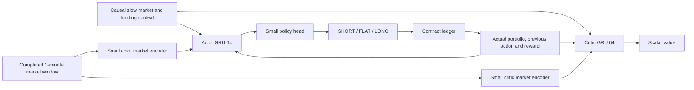

**CryptoRL investigation and proposed next experiment — 5 September 2026**

The evidence does not support a claim that one more GRU configuration or a better critic learning rate will solve the trading problem. Several distinct failures have accumulated: weak or unstable market timing, expensive exploration, persistent exposure under deterministic execution, a policy representation that now excludes the information needed for the requested position management, and changes in the instrument and evaluation protocol. There are also specific implementation and diagnostic issues worth correcting. These are separable problems, and the next experiment should make them separately measurable.

My recommendation is a position-aware recurrent actor–critic with five-minute decisions and one-minute accounting, trained first as a single PPO policy. Both actor and critic should receive market information and the actual account state. Use independent recurrent networks initially, an exact perpetual-contract ledger, a simple economic reward, consistent value units, and horizons defined in elapsed time. Add an ensemble after the single-policy experiment establishes repeatable economic behavior. A second, particularly relevant research arm is to learn the consequences of all three actions from the historical simulator instead of depending entirely on costly sampled exploration.

This is a research proposal with better diagnostics and closer alignment to the requested task. Its profitability is unproven.

**Scope and reproducibility**

Archive note (6 September): this is the historical investigation. Its source and result links now point to the preserved pre-v4 archive. The subsequent implementation and background protocol are documented in [the current README](../../README.md).

I recovered the interrupted local conversation and its temporary research outputs, then checked the main findings against the repository, recomputed the log aggregates and market audit, inspected the recorded orders, and reproduced a value-scaling inconsistency. No training implementation was changed and no new market training was launched.

The audit parsed **2,047 `training.json` records and 624,617 associated update entries**, with no JSON parsing errors. These are saved records, including archived copies, tuning jobs and smoke runs; they are not 2,047 independent confirmations. Ten archived records still say `running`, which is not evidence of ten currently active processes. The direct walk-forward studies store another **180 run reports with 5,660 retraining-block records** across the one-hour and four-hour experiments.

The literature inventory contains 75 PDFs. Seventeen relevant papers had full text extracted during the recovered investigation; the review concentrates on their relevant methods and results. The broader catalogue was screened for relevance, rather than treating every market-making, execution, hedging and simulation paper as evidence for directional BTC trading.

The earliest five-minute experiment's original artifacts were removed. Its results below are explicitly attributed to [the archived history](../../backup/HISTORY.md), not independently reconstructed. The retired Binance Spot data are also absent, so their full historical backtests cannot currently be reproduced from the retained data. Existing order CSVs and financial reports remain inspectable.

Reproduction command, from the repository root:

```bash
model/.venv/bin/python model/research/2026-09-05-review/collect_evidence.py
```

Outputs: [run-level training metrics](training_records.csv), [training summary](training_summary.json), [economic records](economics.json), [market audit](market_audit.json), and [scaling reproduction](scale_reproduction.json). Summary training statistics use the final quarter of each run, with a five-update minimum for short runs, followed by aggregation across runs. Current model tests: **13 passed, 5 skipped**; the skipped checks require the deliberately retired Spot dataset. These checks do not establish financial correctness for a future BitMEX environment.

**What the experiments actually show**

Returns in this table use each experiment's own period and assumptions. They should not be ranked against one another as if they were a common benchmark.

| Experiment | Period or evidence | Recorded outcome | Interpretation |
|---|---|---|---|
| Original five-minute PPO | Archived history; original artifacts unavailable | All five seeds lost; test range −21.7% to −81.7%. Reported zero-cost action replay: −7.7% to +6.3%. | Costs overwhelmed weak timing; the history describes nearly uniform action probabilities. |
| Hourly PPO, shared GRU, log-equity reward | June 2025–May 2026 | Median economic return −11.18%; 2/10 seeds positive. Separately trained zero-cost arm +19.86% median. | Economic policies still chose poor exposure after sharply reducing turnover. The two training arms are different policies. |
| Hourly direct reinforcement, no critic | Same test year | −23.31% median even at 1 bp one way; those economic action paths repriced at 4 bp returned −72.44% median. | Removing the critic did not solve the problem; turnover remained costly. |
| Direct reinforcement with walk-forward retraining | June 2024–May 2026 | One-hour: −11.45%; four-hour: −9.64%; 0/10 positive on either clock. | Repeated adaptation and slower decisions were insufficient. |
| Revised hourly PPO, normalized targets/short discount | June 2025–May 2026 | −12.69% median economic return; zero-cost validation gate failed. | Some optimization changes helped diagnostics, without establishing robust trading. |
| Position-independent v1 with fractional exposure and execution adjustment | Pooled development, 2022–2025 | +18.53% at 4 bp; Sharpe 0.169; −32.51% drawdown. At 8 bp, −2.24%. | A marginal development result depended on an execution adjustment and cost assumptions. |
| Spot v2, selected separate GRU/downside objective | Pooled development, 2020–2025 | +31.81% at 4 bp; Sharpe 0.215; −31.09% drawdown. At 8 bp, −12.39%. | Positive development performance, but limited economic margin. |
| Spot v2 ensemble | January–July 2026, already exposed at project level | +3.99%; 12 orders, comprising six one-hour round trips. | Too concentrated to establish broad trading competence. |
| Spot v3, one-minute inputs/hourly decisions | Same exposed 2026 period | +3.92%; exactly one BUY and no SELL; −29.36% drawdown. | A single entry followed by holding dominates the result. |

Sources: [hourly PPO](../../backup/artifacts/btc1h_gru_ppo_equity/FINAL_REPORT.md), [direct reinforcement](../../backup/artifacts/btc1h_gru_ddr/FINAL_REPORT.md), [one-hour walk-forward](../../backup/artifacts/btc_wf_1h/FINAL_REPORT.md), [four-hour walk-forward](../../backup/artifacts/btc_wf_4h/FINAL_REPORT.md), [revised PPO](../../backup/results_pre_redesign_20260903/artifacts/FINAL_REPORT.md), [position-independent v1](../../backup/position_independent_v1_20260903/position_independent_v1/final_report.md), [Spot v2 development](../../backup/spot_before_perpetual_v4_20260905/results/spot_v2/development_report.json), [Spot v2 evaluation](../../backup/spot_before_perpetual_v4_20260905/results/spot_v2/locked_2026_report.json), [Spot v3 evaluation](../../backup/spot_before_perpetual_v4_20260905/results/spot_v3_1m/test_2026_report.json).

The archived DSR and first-hourly packages are useful implementation history, but they do not each have a complete retained outcome record. The online volatility-event package contains its own objectives, execution machinery and documented earlier defects; the backup README identifies the final online module as not launched. I would not count code availability as evidence that a completed experiment tested the final version.

The most instructive comparison is within an experiment. The four-hour walk-forward study's median price-P&L contribution was approximately −6.53%, funding −0.71%, and cost −2.33%, in the report's summed interval-return units. It was not merely a profitable strategy destroyed by commissions. Conversely, direct reinforcement at its assumed 1 bp cost lost much more when the same positions were charged 4 bp. Both poor timing and execution economics need attention.

**The current model is structurally different from the requested trader**

[The current README](../../README.md) correctly states that the BitMEX import was data-only. The source still implements long-only Binance Spot. SELL closes BTC into cash; it cannot open a short. Funding and inverse-contract mechanics are absent. The thesis framework is also stale: it describes a different multi-asset Binance experiment, not the latest source or retained BitMEX data.

In [model.py](../../backup/spot_before_perpetual_v4_20260905/src/model.py), the actor head takes the market representation alone. Only the critic receives the seven portfolio features. The inventory mask changes which orders can execute, but the actor's preference between SELL and HOLD cannot depend on unrealized P&L, position age, drawdown or available margin. This is enforced by a position-invariance test. It is an intentional design constraint, not an accidental missing tensor.

A useful distinction is between a **market encoder**, which may remain independent of the account, and a **decision policy**, which needs the account state to judge the value of entering, retaining or closing exposure. The earlier absorbing-position issue does not justify removing that state from the actor. Address it through training coverage, reward/accounting checks and behavioral diagnostics.

The latest ensemble demonstrates why this matters. Across 4,847 scored hours, it bought on **5 February 2026 at 21:00 UTC** and never sold. Starting from BTC instead of cash produced **−24.35%**, no orders and a **−40.31%** drawdown. The 28.27-percentage-point return difference and 861-hour convergence delay show that initial inventory materially determined the outcome. Different starting portfolios need not earn identical returns—turnover costs make that unrealistic—but this is a useful diagnostic of persistent exposure.

All five raw seed opinions agreed 99.28% of the time, overwhelmingly on HOLD. That number indicates agreement, not independent evidence of a good strategy. One seed stayed entirely in cash; two reproduced the ensemble's entry; another lost 20.60%; the most active seed made 19 orders and earned 0.54%.

Spot v2's apparent success has a different concentration problem. Five of its six round trips occurred around 5–6 February; the other occurred on 25 June. There were only six invested hours. A reported Sharpe of 1.17 from that path is not equivalent to reliable performance across hundreds of independent trading opportunities. Examine event concentration and block-bootstrap uncertainty before attributing the result to a general trading logic.

**Optimization findings: verified defects, informative diagnostics, and limits**

1. **The training and deployment action distributions differ substantially.** In Spot v3's final training quarter, median turnover was 0.1906 position changes per hour and median entropy 0.4575 nats. The frozen deterministic ensemble changed position once during the evaluation period. At 4 bp per change, 0.1906 changes/hour implies about 18.3 bp/day of direct trading cost before price P&L. Training on stochastic actions and evaluating argmax is a legitimate choice, but these are markedly different behavioral distributions. The current entropy controller targets 60% of the executable two-action maximum and can maintain costly exploration after the economic policy should become selective. The archived concern study makes this tangible: median validation log return was +0.0886 under argmax and −0.8841 under sampling for its selected configuration. This does not prove that argmax is always better; it shows that the deployed policy must be evaluated explicitly throughout development. [Concern study](../../backup/results_pre_redesign_20260903/artifacts/concern_study/REPORT.md)

2. **The latest value function explains little of its targets.** The median final-quarter pre-update explained variance was 0.00035, and post-update 0.00294. Median critic prediction dispersion was 0.0844 versus target dispersion 0.7885. That is consistent with weak predictive value estimates. However, financial reward noise limits achievable EV; EV near zero alone does not prove PPO cannot improve. Post-update EV also measures fitting the current batch, not generalization. Measure fresh-rollout EV, bias/RMSE, target dispersion and variance reduction of advantages, conditional on position and market conditions. Do not select a trader mainly because its critic has a larger EV.

3. **There is a reproducible return-unit inconsistency.** In [ppo.py](../../backup/spot_before_perpetual_v4_20260905/src/ppo.py), `update()` changes the return scale before GAE, divides rewards by the new scale, and combines them with stored values and bootstrap values without corresponding conversion. Suppose raw reward is always 1, gamma is 0.9, and a perfect raw value is 10. If the scale changes from 1 to 2, the current calculation yields an advantage of −0.5; consistently expressed values yield zero. The reproduction uses the actual `advantages()` method. Its contribution to historical losses has not been quantified. Prefer a fixed training-only reward scale initially, or implement consistent value-output normalization such as a properly handled PopArt-style transformation. [Reproduction](scale_reproduction.json)

4. **Recurrent replay is improved, but its invariant has a specific scope.** All five v3 runs recorded zero maximum pre-update probability-ratio and value replay errors. This supports correct replay of the collected sequences, including stored reset states. After an optimizer update, however, the trainer carries the previously collected hidden state onward and detaches it; it does not reconstruct that state under the new parameters. PPO minibatches likewise use stored boundary states. This is a common approximation, but a pre-update replay check does not measure representation staleness after weights change. Compare it with current-parameter burn-in from an actual causal prefix; log the resulting hidden/logit discrepancy. Do not claim that a 240-hour warm-up proves effective memory of 240 hours.

5. **Global gradient clipping still couples separate losses.** Joint epochs clip all model parameters together. Even with detached or separate encoders, a large critic norm can reduce the actor's applied gradient through the common clipping multiplier. Separate clipping budgets make an actor/critic comparison cleaner. In shared mode, also measure relative gradient magnitudes; cosine alone does not tell which objective dominates. Some archived aggressive configurations have enormous recorded pre-clipping norms—up to a final-quarter mean around 7.3e17—despite being marked completed. They warrant numerical exclusion criteria, not the inference that the latest runs are similarly unstable.

6. **The two-step causal-horizon argument is wrong for this policy class.** [An older PPO module](../../backup/model_pre_position_independent_20260903_src/ppo.py) argues that an action can influence only its own price return and the next switching cost. That holds only under a restricted assumption about subsequent actions being unaffected by the current position. Here subsequent decisions can depend on the inherited position. Entering now and subsequently holding can affect rewards much later. Gamma specifies the economic objective; lambda controls an estimator's bias/variance tradeoff. The decay of GAE weights is not a proof about how long an action can matter. [GAE paper](https://arxiv.org/abs/1506.02438)

7. **Zero clipping is not a learning objective or a proof of no learning.** PPO clipping constrains updates relative to a behavior policy, not cumulative movement over hundreds of updates. The old comment that all 320 hourly-PPO runs had zero clipping on every update is also factually inaccurate: 7,897 of their 186,000 saved update rows have positive clip fractions. Most were small. Increasing learning rate until clipping becomes active can amplify noise and recurrent instability. Use KL as an upper control on policy change and verify actual economic learning. [PPO paper](https://arxiv.org/abs/1707.06347)

These findings support implementation corrections and a controlled experiment. They do not establish that those corrections would turn historical losses into profits.

**The data change requires an environment redesign**

The retained dataset has **5,005,040 regular-trade one-minute OHLCV rows** from 13 May 2016 through 1 August 2026, plus **11,153 funding settlements**. These are bars, not tick-by-tick or order-book observations. The manifest records 369,760 minutes without regular-trade bars through the requested endpoint; the internal first-to-last-bar audit finds 369,754, with the six-minute difference at the end of the requested interval. Timestamp duplicates: zero. [Manifest](../../data/bitmex_xbtusd_1m_2016_2026_08_01/manifest.json)

The current feature builder expects `quote_volume`, `taker_buy_quote` and Binance close timestamps, which are not in the retained six-column OHLCV file. Bid/ask spreads, order-book imbalance, depth, mark prices, reference indexes, and historically published forward funding estimates cannot be reconstructed from these columns. Do not substitute fabricated zero-valued microstructure features or call volume imbalance an observed feature when it is unavailable.

The existing gap policy requires 241 complete consecutive hours before accepting a decision. The data audit found **no entirely populated within-year ten-day minute window in any year from 2022 onward**. Applying the existing policy to BitMEX would severely distort or eliminate recent training/evaluation coverage. In 2016, about 67.6% of minutes within the observed year span have no regular-trade bar. Modern missing shares are smaller but still enough to break the ten-day requirement.

Keep the raw table immutable. Build a separate regular-grid observation view that carries the last observed price only as a marked stale observation, sets known no-trade volume to zero, and exposes trade-presence and time-since-trade features. Do not equate a carried observation price with an executable fill or an actual exchange mark. Defer simulated execution until an eligible observed trade under an explicit latency/slippage convention. Preserve contract holdings and funding obligations across missing observations. A verified data outage is different from a minute with no eligible regular trade; retain that distinction. Bar data still cannot verify fills or queue position.

XBTUSD is an **inverse, BTC-margined contract**. For signed contracts N with a USD 1 multiplier, contract P&L in BTC is `N * (1 / entry_price - 1 / exit_price)`. Fees and funding must use the appropriate BTC-valued notional. Marking for unrealized P&L and liquidation is distinct from the execution price. The current linear/Spot equity recurrence is not a substitute. [BitMEX inverse-contract guide](https://www.bitmex.com/app/inversePerpetualsGuide), [P&L guide](https://www.bitmex.com/app/pnlGuide)

One objective choice must be explicit: with BTC collateral, **zero futures contracts still leaves BTC/USD exposure in the wallet**. For this dataset I would first measure incremental trading success in BTC equity, with the unchanged BTC wallet as the baseline, and report USD equity alongside it. A USD cash-neutral objective needs different exposure accounting, including the collateral hedge, or a linear stablecoin-margined instrument. Silently treating XBTUSD FLAT as stable USD cash would change the problem.

The retained funding timestamps are settlement times, not publication times. Apply each realized cash flow once at settlement to the position held immediately before the event, under a documented event ordering. The historical file includes 22 daily-interval settlements as well as eight-hour settlements; a universal current schedule is not a valid historical reconstruction. Observation features may use the last settled rate and causally known schedule information. Do not expose the next realized rate early. Historical fee schedules and account tiers likewise need explicit assumptions; the Spot experiments' 4 bp convention is not verified historical BitMEX execution cost.

Without mark/index data, true margin and liquidation paths remain only approximations. Retain that limitation in an OHLCV-only research study; obtain the required reference data before claiming an exchange-faithful leveraged backtest.

**What to borrow from the papers**

[Borrageiro et al., the crypto agent](../../../articles/problems/optimal%20trading/borrageiro2022b.pdf) is particularly relevant, but it uses the same contract rather than the same information set or learning protocol. It combines an echo-state representation with a direct recurrent learner, observes order-book/trade information, feeds back prior positions, learns online, and accounts for funding and bid/ask execution costs. Its five-minute sampling choice was driven by a data-vendor retrieval constraint. The paper reports 350% return over roughly five years, with 71% attributed to funding. It additionally closes positions when estimated expected reward becomes negative. That last component is an explicit trading rule and does not satisfy the requested fully learned exit behavior. The portable ideas are position feedback, accounting for all economic cash flows, recurrent representation and causal adaptation—not a claim that five minutes is universally optimal. [Public paper](https://arxiv.org/abs/2201.04699)

The paper's discussion that value learning can mistakenly reward a flat position after a price jump is not a general objection to TD learning. With a correctly defined portfolio reward, a flat position earns no directional P&L from that jump. Correct action/reward alignment matters more than that argument for choosing direct reinforcement over PPO.

[Moody (1998)](../../../articles/problems/optimal%20trading/moody1998.pdf) and [Moody (2001)](../../../articles/problems/optimal%20trading/moody2001.pdf) support direct optimization of trading performance and feeding prior decisions into a trading system. They do not imply that modern markets supply sufficient exploitable signal or that a Sharpe-derived reward is always easiest to optimize. Your no-critic experiments are empirical reasons to avoid treating direct reinforcement as an automatic cure.

[Carapuco (2018)](../../../articles/problems/optimal%20trading/carapuco2018.pdf) explicitly supplies position, unrealized profit and account information. This supports the relevance of functional portfolio inputs, although its FX setting and action semantics differ. [Ni et al.](https://proceedings.mlr.press/v162/ni22a/ni22a.pdf) find that recurrent architecture, separate encoders, sequence length and previous-action/reward inputs materially affect POMDP learning. Their principal experiments concern off-policy methods, so this motivates a PPO design/ablation rather than proving superiority for BTC PPO.

[Huang (2018)](../../../articles/problems/optimal%20trading/chienyi2018.pdf) is a useful next research direction: its action augmentation learns from all actions under a price-taking market assumption. [Bisi (2020)](../../../articles/problems/optimal%20trading/bisi2020.pdf) provides a batch value-learning/risk-sensitive comparison. These are closer to an experiment about sample efficiency than adding ever more reward penalties. [Expected policy gradients](https://jmlr.org/papers/volume21/18-012/18-012.pdf) provides the general rationale for summing across actions to reduce action-sampling variance.

[Yang (2020)](../../../articles/problems/optimal%20trading/yang2020.pdf) calls a rolling selection among PPO/A2C/DDPG agents an ensemble strategy. [Carta (2021b)](../../../articles/problems/optimal%20trading/carta2021b.pdf) studies combinations of repeated learning runs. These support multiple ensemble forms; neither guarantees useful diversity from different seeds. The other Carta paper contains supervised classifiers and a meta-learner, so it is not a direct template for the requested pure-RL design. [Zhang, Zohren and Roberts](../../../articles/problems/optimal%20trading/zang2020.pdf) use many futures markets and volatility-scaled trading, a materially different breadth of training experience. The newer imitation, stopping-time and multi-component-reward papers are possible later research directions, not evidence that their extra machinery fixes this implementation.

**Recommended environment and action semantics**

Use **one-minute accounting and observations, with a decision every five minutes** as the first experiment. This gives the agent twelve opportunities per hour to reconsider its position, while avoiding the most demanding one-minute exploration/cost setting. It can hold for hours or days through repeated retention decisions. Monitoring every five minutes does not require trading every five minutes.

Use three unambiguous side targets: **SHORT, FLAT, LONG**. FLAT closes an open contract position or remains uninvested in contracts. Selecting the existing side retains its contracts. Selecting the opposite side closes and reopens, paying both legs. This implements entering, exiting and holding without a prescribed holding duration, stop-loss, take-profit, probability threshold or forced trade count.

For the initial experiment, size an entry at a fixed, modest fraction of contemporaneous equity and keep the contract quantity unchanged until exit/reversal. Start with 1x entry notional as a reference experiment only after validating its margin mechanics. This is different from maintaining exactly 1x exposure at every decision: the latter requires rebalancing as equity changes, and every rebalance must be charged. Report realized exposure drift. Position sizing can be expanded to a small discrete ladder later, once directional/holding behavior is established.

Keep account accounting exact for the selected contract and objective currency. Mark open positions each minute. Sum the ensuing five minutes' log-equity increments for each decision reward, including intervening funding and actual turnover cost. Do not reward only realized closes; that hides ongoing risk and delays feedback. Use `reward = C * log(E_next / E_now)` with one fixed positive training scale C. A losing period is already penalized by its economic loss; repeatedly charging an accumulated open loss adds a different preference, which must be justified and isolated in a later ablation.

Artificial training chunks are time limits: bootstrap their continuation values and stop GAE recursion across a reset. Bankruptcy or exchange liquidation is an economic termination with appropriate terminal treatment. The final backtest should specify both marked wealth and wealth after charging any final liquidation. Never erase an inherited position or accumulated funding simply because a feature window ended.

**Recommended state and network**

At time t, supply only observations available before the order's simulated execution. The initial state should contain:

| Component | Proposed content | Purpose |
|---|---|---|
| Fast market history | Last 60–120 completed one-minute bars, represented by returns, range, candle shape and volume changes; explicit observation-presence/staleness features | Short-term path and trading activity without raw-price-level dependence |
| Slow market context | Causal multi-hour/multi-day momentum, realized volatility, relative volume; last settled funding and known schedule state | Context beyond the fast observation window |
| Actual account state | Contract side and quantity, exposure/equity, unrealized return, position age, running favorable/adverse excursion, equity drawdown, available margin, accumulated funding/cost for the open trade | Consequences and risks of the position already held |
| Previous interaction | Previous executed action and previous realized economic reward | Recurrent history of actual behavior and outcomes |

Do not use unavailable order-book features. Keep feature transformations causal, estimate parameters on each training fold, and monitor clipping/staleness by era. Historical entry price and unrealized P&L are not magical predictors: under a fully observed model some are redundant or sunk-cost information. They can help with partial observability and risk accounting, but the agent should learn whether they are useful; it should not be taught to wait for breakeven.

The network should separate fast-market compression from decision-time memory:



A small local GRU or temporal convolution can compress the market window to 32–64 values; a separate 64-unit decision GRU then integrates those values with slow features and account history at five-minute intervals. The critic has its own encoder and recurrent state. Use small 32–64-unit heads. This creates a direct path for learning position management and avoids asking a single GRU to carry all information through thousands of minute-level recurrent steps.

The current model flattens a 128-hour rollout into **7,680 recurrent minute steps**. Slow context and portfolio features enter heads after that recurrent stream rather than becoming decision-time memory. This is a plausible representation/credit-assignment bottleneck, not a demonstrated cause of all losses. Compare the proposed factorization to the existing single stream and to a small feedforward baseline.

Why start separate? The critic can learn its own useful representation without changing the actor's through the value loss. Detaching the critic from the actor encoder prevents interference but also prevents it from improving that encoder for value prediction. Shared encoders may be more efficient and should remain an ablation. Your evidence does not identify a universal winner: the old concern study slightly favored detached representations, whereas the selected Spot v2 configuration used a separate GRU. Those comparisons also differ in objective and other settings.

**Training parameters and credit assignment**

Use these as a declared starting experiment, not as claimed optimal hyperparameters:

| Item | Starting specification |
|---|---|
| PPO | Standard clipped categorical PPO, with true executed-action semantics |
| Actor / critic learning rates | 1e-4 / 3e-4 after fixing value units |
| Encoders | Separate actor and critic; no shared gradient clipping budget |
| Parallel environments | 16–32 independent contiguous training windows |
| Rollout | Approximately two days per environment; 512 five-minute decisions is 42.7 hours |
| Sequence updates | Ordered 128–256 decision chunks, with 64–128 prior decisions as causal burn-in; validate longer context if behavior depends on it |
| PPO epochs | 3–4 initially; critic extra passes only if fresh-rollout diagnostics justify them |
| Clip range / KL control | Clip 0.2; measured KL upper target around 0.01 with early stopping; no requirement to hit a clipping quota |
| Entropy | Small starting bonus, e.g. 0.005 after advantage standardization, decaying toward zero; validate the schedule rather than enforcing a high permanent entropy target |
| Reward | Fixed-scale net log equity, no hidden switching-cost adjustment in logits |
| Initial accounts | Primarily flat starts; supplement with coherently reconstructed inherited positions/account histories from causal prefixes |
| Windows | Contiguous chronological episodes long enough for multi-day holds, randomly located within training only |

At five-minute decisions, a **24-hour discount half-life** corresponds to `gamma = 2^(-5/1440) = 0.997596`. With a **two-hour GAE-weight half-life**, `gamma * lambda = 2^(-5/120)`, giving `lambda = 0.973873`. The GAE weights' corresponding geometric effective span is about 2.93 hours, not two hours; half-life and effective span are different quantities. Bootstrapping supplies longer-horizon value information. These are interpretable initial choices; compare a small number of economic half-lives, such as 6, 24 and 72 hours, within development.

For a fair frequency comparison, preserve physical horizons:

| Decision interval | Gamma for 24-hour half-life | Lambda for two-hour GAE-weight half-life |
|---|---:|---:|
| 1 minute | 0.999519 | 0.994719 |
| 5 minutes | 0.997596 | 0.973873 |
| 60 minutes | 0.971532 | 0.727827 |

These lambda differences are expected when preserving elapsed-time decay. Use equivalent calendar observation windows, approximate rollout duration, fees and execution assumptions as well. Reusing gamma=0.95 at one, five and sixty minutes compares different economic objectives: its half-life is about 13.5 minutes, 67.6 minutes and 13.5 hours respectively.

Reconstruct recurrent prefixes under current parameters for PPO replay where feasible. Keep recorded behavior log probabilities unchanged. For portfolio-conditioned recurrence, replay the **recorded actual actions, rewards and portfolio observations**, rather than generating a different hypothetical account during burn-in. Refresh the continuation state after updates, and measure finite-prefix approximation errors. Preserve the existing exact pre-update replay guard, including resets and time-limit bootstrap checks.

The present regime-balanced sampler uses future block outcomes only to choose training windows, not as policy inputs; this is not automatically test leakage. It does change the training distribution. Establish a uniform chronological-block baseline and treat outcome-balanced sampling as an ablation. Random seeds and overlapping windows do not create new market regimes. Early illiquid BitMEX history should have an explicit sensitivity analysis rather than automatically receiving equal economic weight because it adds years.

**A more promising research extension than another reward formula**

Historical replay gives this task a useful structure. For a small price-taking agent, choosing SHORT instead of LONG changes its account, not the next observed market bar. After observing a training transition, the simulator can compute the immediate reward and next account state for **every available action**.

Use that initially to train an auxiliary three-output Q critic, and compare it against the standard value critic. A next-stage expected actor–critic can evaluate:

`Q_target(h, a) = r(h, a) + gamma * E_policy[Q_target_network(h_next(a), a_next)]`

Each branch needs its own next portfolio state, previous action/reward inputs, and recurrent continuation. Do not reuse a common next portfolio or bootstrap from the old position. Only the market transition is shared. Terminal events, funding, slippage and position-dependent costs remain action-specific.

This supplies more information per observed training transition and can reduce dependence on repeatedly paying simulated exploration costs to discover already-computable alternatives. It remains trial-and-error control learning in the simulator. It does not require manual buy/sell labels or a hardcoded holding rule. It cannot remove market-transition noise or create unseen regimes.

If the actor is updated by summing over these action values, that is a distinct expected-policy-gradient or policy-iteration method, **not ordinary sampled PPO**. Do not put invented counterfactual trajectories into PPO as though they were on-policy samples with valid old log probabilities. Use a target critic, constrain policy changes, and compare against standard PPO on the same folds. This extension is motivated by the structure of the simulator and the cited action-augmentation/expected-gradient literature; it has not been tested here.

**What qualifies as ensemble learning**

Yes: training five policies with different seeds and combining their predictions or actions is a homogeneous ensemble. Averaging their reported returns is an experiment summary, not an executed ensemble. Averaging arbitrary independently trained GRU weights is also not interchangeable with combining their outputs.

Start with an equal-weight mixture of **action probabilities**. Every member must receive the same real portfolio and executed interaction history, while maintaining its own recurrent hidden state. Execute one combined action, update one account, and feed that outcome back to all members. Do not combine decisions conditioned on five incompatible shadow portfolios.

The current mean-logit method is also a valid ensemble rule. Mathematically, its softmax corresponds to a normalized geometric combination of the members' probabilities, so members with sharper distributions can have stronger influence. An arithmetic probability mixture is an easier initial interpretation of equal-weight voting. Neither is guaranteed superior; choose the aggregation method on development data.

Keep seeds as repeated estimates of a training procedure, not labels such as bull expert or bear expert. If the base agent works, introduce purposeful but limited diversity through chronological block resampling, different validated recency weightings, or complementary market representations. Keep economic semantics and action definitions common. Measure net-return correlation, disagreement on actual transition opportunities, downside co-movement, and performance versus the median member. Raw agreement dominated by HOLD is uninformative about diversification. Learned gating or performance-based weights need their own causal development evaluation.

**How to evaluate progress and decide whether to continue**

The archive's repeatedly inspected 2025–2026 periods and the current `locked_previously_exposed` labels should be treated as development evidence for this redesign. Changing exchange data or model names does not erase knowledge gained from the same BTC episode. Reserve a chronologically new confirmation period after freezing the procedure, and use forward paper trading to assess execution assumptions. Do not choose a seed, checkpoint or aggregation rule on that confirmation period.

Proceed in this order:

1. Validate a single perpetual ledger against hand-computed long/short/flat paths, inverse P&L, entry/exit/reversal cost, funding on both sides of a decision boundary, missing observations and truncations. Check causal features and execution lag. Test the intended objective currency and collateral exposure explicitly.
2. Demonstrate that the small agent can learn on a controlled synthetic market with a known persistent signal, and that it does not earn an unexplained edge on a martingale with zero funding and positive costs. These are diagnostic environments, not evidence of profitability on BTC. A deterministic perfect-information action planner can provide an upper-bound accounting check; do not give it to the deployed policy as an input.
3. Run single-agent PPO on several chronological walk-forward development folds. Include bullish, bearish, sideways and illiquid eras. Compare separate/shared/detached encoders only after the account state, reward, execution, calendar horizon and training budget are held fixed. Report learning curves across a small preregistered budget grid; 225 updates is not inherently convergence.
4. Compare five-minute decisions with hourly and one-minute decisions at matched physical horizons. Judge net behavior and stability, not decision count. Keep short- and long-history/recency weighting as a small, explicit ablation.
5. Evaluate the all-action critic/expected-actor extension separately if ordinary PPO remains action-sample inefficient. Compare the five-seed ensemble to its members only after the base experiment has meaningful behavior.
6. Freeze the full procedure, including normalizer, retraining cadence, costs, action selection and ensemble aggregation. Evaluate a new period once and continue with causal paper trading.

For every candidate, report both gross and net results, funding contribution, collateral benchmark, cost/latency sensitivity, long/short/flat occupancy, completed round trips, entry/exit behavior, holding-time distribution and whether one event supplies most of the profit. Examine performance conditional on open P&L, age, margin and volatility. Use paired daily returns and a block bootstrap to retain temporal dependence; five seeds are not five independent market histories. Report dispersion and uncertainty rather than only a mean or best Sharpe. [Agarwal et al.](https://arxiv.org/abs/2108.13264)

Use a no-contract baseline, long/short contract baselines under the correct collateral convention, simple momentum and a small feedforward learner as controls. Benchmark rules are diagnostic comparisons; they need not constrain the RL policy. Reprice the *same frozen action path* at multiple costs to isolate execution economics, and separately label any zero-cost-trained policy. If account observations depend on costs, also rerun the full policy under each cost scenario to show behavioral sensitivity.

The old ridge probes showed weak linear predictive information at short horizons relative to a stylized turnover hurdle. That is useful negative evidence about those features and that probe, not an impossibility theorem for a nonlinear policy with selective entries and long holding periods. A failed linear probe should not be the sole veto on training. Conversely, if the agent cannot beat controls or matched-exposure timing nulls before costs on multiple development eras, another entropy schedule is unlikely to be the best use of time. The next work should then target data/representation, the economic objective, or the hypothesis that the available information contains an exploitable edge.

Finally, learning trading logic does not require predicting the exact next BTC price. It does require some stable relationship between current information and the consequences of actions, whether through conditional returns, funding, risk or transaction-cost avoidance. Ten years of one asset is useful experience, but it is a single nonstationary history with correlated observations and changing liquidity. Repeated training cannot guarantee that a transferable advantage exists. The proposed design makes that question testable while allowing the agent to learn its own entry, retention and exit behavior.
