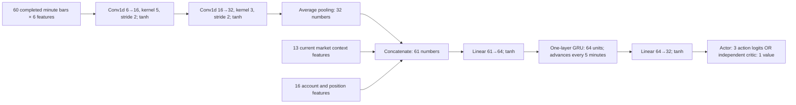

**Seed 11: trade attribution, current architecture, and a recurrent research direction**

Audit date: 6 September 2026. “Seed 1” in the request is interpreted as seed 11,
the profitable 2024 development run. The completed experiment used seeds 11, 29,
47, 71 and 101. The model examined here is
[2024 seed 11, update 300](../../results/perpetual_v4/runs/2024/seed_11/validation_0300.json),
trained on 2017–2023. It is a different checkpoint from the final seed 11 model
trained through 2025. All new evaluations use 2024 development data. Data from
2026 onward remain locked. No training or changes to the frozen experiment
source were made for this analysis.

**What made money**

The model appears to have learned a rare, long-only rebound strategy following
sharp declines in unusually volatile conditions. This interpretation comes from
the recorded entry states, trade outcomes and controlled input interventions;
it is not a trading rule imposed on the agent or a claim that its internal
reasoning has been recovered completely.

| Selected checkpoint, calendar 2024 | Result |
|---|---:|
| Net BTC return | +16.0961% |
| Starting / ending account equity | 1 / 1.16096079 BTC |
| Maximum drawdown in saved five-minute equity | −10.3489% |
| Completed trades | 25, all long |
| Winning / losing trades | 19 / 6 |
| Distinct entry days | 17 |
| Median / mean holding time | 50 / 74.2 minutes |
| Minimum / maximum holding time | 10 / 260 minutes |
| Total time holding contracts | 30 hours 55 minutes, about 0.352% of the year |
| Mean winning / losing trade return | +1.1795% / −1.1975% |
| Profit factor, BTC profits divided by absolute BTC losses | 3.031 |

The following is an exact additive decomposition using the original contracts,
unadjusted market execution prices, adverse fills, commissions and actual
funding events. Each trade reconciles to the saved account ledger within
1e−11 BTC. These are contributions relative to the initial 1 BTC account,
not independently compounded strategy returns.

| Component | BTC contribution |
|---|---:|
| Price movement before execution costs | +0.19446287 |
| Adverse slippage | −0.00539824 |
| Commissions | −0.02699122 |
| Funding | −0.00111262 |
| Net profit | **+0.16096079** |

Funding was a small net cost. The profit came from favorable price movements
during the positions. There were gains in all four quarters: approximately
6.25%, 4.63%, 3.82% and 0.59%. Removing the best recorded trade leaves a
compounded return of +10.72%; removing the best entry day leaves +12.80%.
These exclusions describe concentration in the original trade returns; they
are not reruns of a policy with those events suppressed.

The median entry followed a one-hour log return of −2.649%, equivalent to
approximately −2.615% simple return. The median entry's one-hour momentum rank
was in the bottom 0.254% of 2024 decision points; its one-hour volatility rank
was at the 99.621st percentile. Median preceding 15-minute and daily log
returns were −0.606% and −6.805%. These are full-year descriptive ranks computed
after the experiment, not inputs available to the policy at those dates.

This is considerably more specific than a generic bullish position. The agent
usually did nothing and entered during rare, sharp selloffs. However, those
entries are clustered in a small number of market events. Millions of minute
bars do not turn 17 active days into millions of independent demonstrations of
a trading edge.

**Did it learn exits and use its position information?**

For each original entry I calculated independent alternative trades with fixed
holding times, including commission, slippage and funding. The original learned
exits had the largest mean net return per trade among these particular choices:

| Exit choice at the same 25 original entries | Mean net return per trade |
|---|---:|
| Learned exit | **+0.6090%** |
| After 15 minutes | −0.1129% |
| After 30 minutes | +0.1704% |
| After 60 minutes | +0.1620% |
| After 120 minutes | +0.1298% |
| After 240 minutes | +0.4278% |

These alternative trades can overlap. This is an entry-matched diagnostic,
not a feasible aggregate strategy comparison or a demonstration of optimal
exit timing. It does provide a reason to investigate the policy's holding and
exit behavior rather than treating the entire result as entry prediction.

I also reconstructed the recurrent histories at all 25 entries, all 25 exits
and one midpoint of every trade. The unmodified model reproduced all 75 saved
actions. I then replaced selected standardized market inputs with their
training means, or replaced account inputs with a neutral flat account:

| Input intervention | Result at the original decision states |
|---|---|
| Remove fast minute information | All 25 entries become FLAT |
| Remove slow momentum information | 24 of 25 entries become FLAT |
| Remove slow volatility information | All 25 entries become FLAT |
| Remove slow relative-volume information | All entries remain LONG; 20 of 25 exits become LONG/continue |
| Remove funding information | Four entries become FLAT; one exit becomes LONG |
| Neutralize current account only | None of the 75 most-likely actions changes |
| Neutralize the entire replayed account history | Five of 25 exits become LONG/continue |

The entry behavior depends on the joint market representation. Relative volume
has a substantial influence on these exit decisions. Current account inputs
have little effect on the action choice at these particular states, but the
accumulated account history affects some exits. The earlier audit's probes at
ordinary, mostly flat moments missed these rare trade states; it would be too
strong to say the profitable policy ignores all position history.

These are input interventions, sometimes creating unusual combinations of
features. They are not additive feature-profit attributions, and changing an
action in this probe does not establish what a complete alternative strategy
would earn.

**Robustness and the seed distinction**

I reran the saved policy over 2024 with higher adverse slippage, retaining the
5 bp commission. Account feedback was recomputed, so these are full development
policy evaluations rather than cost subtractions from fixed trades.

| Total assumed cost per execution leg | Net BTC return | Saved-equity maximum drawdown | Trades |
|---|---:|---:|---:|
| 6 bp: 5 fee + 1 slippage | +16.10% | −10.35% | 25 |
| 8 bp: 5 fee + 3 slippage | +14.18% | −10.53% | 25 |
| 10 bp: 5 fee + 5 slippage | +13.06% | −10.71% | 25 |

This result survives the tested cost increases. The simulation still uses
regular-trade OHLCV and assumed adverse fills, not reconstructed historical
order books, latency and exchange mark prices. That matters especially because
the policy concentrates activity in volatile events.

All eight saved checkpoints for this 2024 seed were profitable on that same
validation year: +17.81%, +14.26%, +6.83%, +10.85%, +12.01%, +16.10%, +10.85%
and +9.61% at updates 50 through 400. Thus the behavior was not isolated to one
checkpoint. These are correlated observations of one training trajectory on
one year, not eight independent replications. The common 300-update budget was
selected across all 15 development runs, not by maximizing this seed's return.

The seed 11 run trained through 2022 made no trades in its 2023 validations.
The run trained through 2024 was flat at the selected checkpoint on 2025.
The final model trained through 2025 also became almost entirely flat in its
training rollouts: 99.995% sampled FLAT over updates 296–300. Its test
performance has not been accessed. A seed identifies random initialization,
episode sampling and action sampling; it does not identify a stable strategy
that survives every training period.

The profitable development run retained more non-flat experience. At updates
46–50 it sampled FLAT about 91.62% of the time, compared with 97.83% and 98.19%
for the other two seed 11 folds. At updates 296–300 its FLAT share was 98.41%,
versus about 99.993% for those folds. Its mean training reward in that last
five-update window was still slightly negative: −0.00030508 in the units
100 × net log BTC change. Training samples the policy distribution; validation
takes its most probable action. A profitable deterministic validation policy
therefore does not imply that sampled training trades were profitable.

Stochastic optimization appears to have preserved a narrow useful behavior in
one training fold. The logs do not isolate whether initialization, sampled
episodes or a particular sequence of rewards caused that difference. Selecting
seed 11 after seeing 2024 would be selection on validation performance, not
evidence that seed 11 is intrinsically better.

**This is single-asset trading**

The instrument is the BitMEX XBTUSD inverse perpetual, with BTC collateral.
There is no allocation across a basket of assets. The source uses the name
`portfolio` for a 16-number vector describing this one trading account and its
position. “Account and position state” is the clearer terminology.

The three actions are target sides: SHORT, FLAT and LONG. Selecting the current
side holds the existing contract quantity; FLAT closes an open position;
selecting the opposite side closes and opens, paying both execution legs.
Contract quantity is fixed at entry from the current BTC account and a 1×
notional setting. There is no learned continuous sizing head and no automatic
rebalancing while holding.

The current objective is net log growth of **BTC equity**. USD equity is also
reported. A flat futures position still holds BTC collateral, so its USD value
moves with BTC. This explains the otherwise confusing USD returns: the 2024
strategy returned +156.27% in USD, while simply retaining the initial BTC
collateral returned +120.74% in USD. The +16.10% BTC result is the relevant
incremental wealth result under the current objective. Choosing the wealth
numeraire and controlling a single derivative position are distinct from
multi-asset portfolio optimization.

**Architecture actually used in v4**

There is both a CNN and a GRU in each of two independent branches. No LSTM is
used. Actor and critic share neither their encoders nor their recurrent weights.

The diagram describes one branch. Actor parameters: 33,171. Critic parameters:
33,105. Total: 66,276. There is no attention, dropout or layer normalization.
GRU recurrent gate weights are orthogonally initialized, input weights use
Xavier initialization and GRU biases are zero. The final actor output layer
uses orthogonal gain 0.01; the final critic output layer uses gain 1.0.

| Input group | Actual information |
|---|---|
| Six minute features, each over the last 60 completed minutes | Close log return; log high/low; log close/open; change in log(1 + contract volume); regular-trade-present flag; log(1 + stale minutes) |
| Seven momentum features | 15 minutes, 1 hour, 3 hours, 12 hours, 1 day, 3 days, 10 days |
| Two volatility features | Root sum of squared minute returns over 1 hour and 24 hours |
| One volume context feature | Relative one-hour volume against the preceding daily volume context |
| Three funding features | Last settled rate, elapsed hours since funding, last known funding interval |
| Sixteen account features | Side; signed exposure; unrealized P&L relative to equity; log holding age; net open-trade log return; favorable and adverse excursions; drawdown from open-trade peak; account drawdown; maintenance headroom proxy; open-trade fees; open-trade funding; previous reward; three previous-action indicators |

Market inputs use training-period means and standard deviations only; standard
deviations are floored at 1e−6 and standardized values clipped to [−8, 8].
Account inputs use explicit scaling and clipping. For example, exposure is
clipped to [−5, 5], P&L-related features are generally multiplied by 10, trade
fees and funding by 100, and holding age is log-scaled relative to approximately
14 days. Exact feature transforms and optimizer defaults are saved in
[current_specification.json](current_specification.json).

The CNN has a confirmed defect: its unpadded strides reduce 60 input bars to
28 and then 13 locations, with the final location ending at input index 56.
The newest three bars, indices 57–59, never reach the fast encoder output.
Input gradients and controlled perturbations both confirm this. The current
slow features still convey the latest close-based momentum and volatility, so
the whole policy is not completely blind to recent information. Average pooling
also removes much of the pattern's location within the hour. The earlier
[architecture audit](../2026-09-06-v4-review/REVIEW.md) contains the reproduction.

**Actual PPO and experiment hyperparameters**

| Parameter | Used value |
|---|---|
| Reward | 100 × log(next BTC equity / previous BTC equity), net of costs and funding |
| Discount γ | 0.9975961328836203; discount half-life 24 hours at five-minute decisions |
| GAE λ | 0.9738730024397007; γλ trace-weight half-life 2 hours |
| Actor / critic learning rates | 0.0001 / 0.0003, constant |
| Optimizers | Separate Adam; β=(0.9, 0.999), ε=1e−8, weight decay 0, AMSGrad off |
| PPO ratio clip | 0.2 |
| Target KL | 0.01; stop actor updates when minibatch estimate exceeds 0.015 |
| Entropy coefficient | Linear 0.005 → 0 over the first 200 completed updates; zero from update 201 |
| Gradient norm cap | 0.5 separately for actor and critic |
| Critic loss | 0.5 × MSE against GAE-based return targets; no value clipping |
| Advantage normalization | Mean/std across valid rollout samples, ε=1e−8 |
| Parallel environments | 16 |
| Rollout per environment | 512 decisions = 42 hours 40 minutes |
| Transitions per update | 8,192 |
| Differentiated sequence length | 128 decisions = 10 hours 40 minutes |
| Initial burn-in | 128 decisions = 10 hours 40 minutes |
| Minibatch | 16 sequences × 128 decisions = 2,048 samples |
| PPO epochs | 4 actor/critic epochs |
| Extra critic epochs | 2 |
| Typical optimizer steps per update | 16 actor, 24 critic, unless actor KL stopping intervenes |
| Training episode | 4,096 decisions = 14 days 5 hours 20 minutes; random contiguous training interval, starts flat |
| Hidden-state replay | Recompute actual prefix with current weights for each minibatch; no gradient through prefix |
| Collection/evaluation recurrent refresh | Every 512 decisions, reconstruct from the preceding 128-step history |
| Replay agreement tolerance | 5e−5 for value and probability-ratio errors |
| Development budget | 400 updates per seed/year, 3,276,800 sampled decisions |
| Validation / policy checkpoint interval | Every 50 updates |
| Full resume checkpoint interval | Every 10 updates |
| Chosen final training budget | 300 updates per seed, 2,457,600 sampled decisions |
| Seeds | 11, 29, 47, 71, 101 |
| Compute | CPU, two simultaneous jobs, two PyTorch threads per job |
| Entry leverage / starting balance | 1× contract notional / 1 BTC |
| Fee / adverse slippage | 5 bp / 1 bp per execution leg |
| Maintenance margin setting | 0.5% proxy; liquidation checks also include closing commission |
| Artificial episode truncation | Bootstrap continuation value |
| Economic termination | Zero continuation value |

The GAE half-life is a decay property of trace weights, not a hard two-hour
reward horizon. Similarly, the recurrent burn-in is not a promise that the
network preserves useful information across all those hours.

Development folds train from 2017 through 2022, 2023 or 2024 and validate on
2023, 2024 or 2025, respectively. December 2016 supplies feature warm-up. Final
retraining uses 2017–2025. All observations are causal. Missing regular-trade
minutes carry the latest close, expose missingness/staleness and prevent fills;
holdings and funding continue to be accounted for. Filling uses the first
eligible minute open after the decision. Funding settles before orders at a
shared boundary. Margin checks use adverse intrabar extrema with trade prices
as a mark proxy.

The current ensemble averages the five action-probability vectors for one
actual account, then takes the largest probability. This is an ensemble across
random seeds, not an allocation across five accounts. Averaging seed results
for reporting alone would not be an ensemble decision policy. In this cohort,
mostly-flat members overwhelm seed 11's rare signals and the ensemble makes
no trades in any of the three validation years. Budget selection used average
individual log returns, which does not directly optimize that deployed mixture.

**What the papers actually support**

CNNs were an engineering choice in v4, not a requirement derived from these
papers. The following descriptions are based on the supplied PDFs, checked
against their primary publications:

| Paper | Actual architecture and relevant lesson |
|---|---|
| [Borrageiro, Firoozye and Barucca, The Recurrent Reinforcement Learning Crypto Agent](https://arxiv.org/abs/2201.04699), local `borrageiro2022b.pdf` | An echo-state recurrent reservoir with 100 units, 75% sparsity and feedback from 10 past positions, followed by direct recurrent reinforcement learning. This is neither a CNN nor GRU/LSTM PPO. It supports recurrent state and position feedback as useful design ideas. |
| [Zhang, Zohren and Roberts, Deep Reinforcement Learning for Trading](https://arxiv.org/pdf/1911.10107), §4.3, local `zang2020.pdf` | Two-layer LSTMs with 64 and 32 units for actor/critic models. This directly supports investigating recurrent encoders. Its daily futures experiments and DQN/PG/A2C methods do not establish the best five-minute BTC PPO settings. |
| [Théate and Ernst, An Application of Deep Reinforcement Learning to Algorithmic Trading](https://arxiv.org/pdf/2004.06627), §§4.2–4.3, local `theate2021.pdf` | Replaces the original DQN CNN with a feedforward network for its time-series inputs. It also executes the alternative action in a copied environment during training. That is a particularly relevant exploration/data-efficiency idea for this problem. |

Borrageiro's five-minute sampling was selected because of the historical data
vendor's retrieval throttle; it is not evidence that five minutes is the
economically optimal decision frequency. The paper uses the same XBTUSD
instrument but also has order-book information, observable spread and basis.
Our OHLCV/funding input is not equivalent. Its method additionally contains an
explicit profitability gate that closes/abstains when estimated mean net reward
is negative, which should not be imported silently into a rule-free learned
policy. [Primary paper](https://discovery.ucl.ac.uk/id/eprint/10147117/1/The_Recurrent_Reinforcement_Learning_Crypto_Agent.pdf).

These papers do not settle GRU versus LSTM for our dataset. A recurrent-only
architecture is a reasonable research choice. GRU is a sensible first model;
LSTM should be a comparison with similar parameter count and training budget.
CNNs can process numerical time series, so the objection here is this
implementation and its suitability, not a claim that convolution only works
on images.

**Proposed recurrent architecture and learning changes — not implemented**

I recommend separating what the market has done from what this account has
experienced, then making both directly available at each decision. A concrete
candidate, using the current five-minute action cadence, is:

1. A **minute GRU with 32 units** reads the last 60 completed minute feature
   vectors chronologically. Its final state includes the newest minute; there
   is no convolution or temporal average pooling.
2. A **market GRU with 64 units** advances every five minutes on that minute
   embedding and the 13 causal context features. Its memory depends only on
   market observations, making it reusable across alternative account paths.
3. A small **position GRU with 16 units** tracks the account-feature history.
   Its added value must be compared with a version that uses current account
   features alone. Seed 11's five history-sensitive exits justify testing it,
   not assuming it is necessary.
4. Concatenate the market memory, position memory, all 16 current account
   features and the 13 current context features: 109 inputs into 64- and
   32-unit decision layers. Current account information reaches the decision
   head directly instead of depending exclusively on retention in a GRU.
5. Keep separate actor and critic parameter sets for the first experiments.
   The actor still produces the probabilities of SHORT, FLAT and LONG; repeated
   side choices learn holding duration. The initial critic retains a V head;
   an experimental auxiliary head predicts the value of each of the three
   target-side choices.

The important training change is to generate informative **alternative account
experiences**. At a training decision, clone the current ledger and simulate
each of the three actions with its own execution cost, funding, quantity and
subsequent account history. Include sustained continuations under the policy,
not just one-step price labels. Replay can retain meaningful open-position
histories that standard on-policy PPO discards. Only training-period outcomes
may supply these learning targets; future outcomes never enter the policy's
decision-time input.

This relies on the existing assumption that the agent is small enough not to
change the historical market path. Counterfactual branches create alternative
account outcomes on the same observed market; they do not create independent
market histories. Executing alternative actions in copied environments already
appears in Théate and Ernst, so that component should not be claimed as new.
[Their method](https://arxiv.org/pdf/2004.06627).

There is an algorithmic distinction to preserve: ordinary PPO's clipped actor
update must use actions actually sampled from its recorded behavior policy.
Copied trajectories are suitable for auxiliary critic learning, not for being
inserted into PPO as if the actor sampled them. With independent actor and
critic networks, improving an auxiliary Q head alone also does not guarantee
that the actor will explore or use it.

A stronger research variant would explicitly add an actor objective favoring
the expected, learned net action values, summing over all three actions. The
Q estimates would be detached in that actor objective and its weight tested
against zero. This is **PPO with an auxiliary action-value objective**, not
unchanged PPO; total policy movement must be monitored. Its benefit and bias
need direct ablation. This makes the proposed transfer from alternative
experience to policy learning explicit.

Exploration should also generate coherent position histories. A learned
continue-versus-change gate is one candidate: when a position is held, the
gate learns whether to retain it and a conditional head chooses the alternative
side when changing. The resulting action probabilities must be used exactly
in PPO likelihood ratios. Any initial persistence bias is an explicit,
trainable exploration prior; it must not impose a minimum holding time or a
market-based entry rule. This requires comparison with the ordinary three-way
head, because a persistence gate could also reinforce remaining flat.

Another experiment is to retain one sampled ensemble hypothesis over a training
episode, enabling temporally consistent exploration while that policy remains
free to close at every decision. This is motivated by existing work on
[deep exploration through randomized value functions](https://arxiv.org/abs/1602.04621),
not a claim that bootstrapped DQN transfers unchanged to PPO. Different seeds
alone did not provide useful diversity in the current run. Any ensemble must
be assessed on the actual single-account decisions it makes.

Do not introduce a reward merely for entering trades, penalize inactivity, or
hardcode buying selloffs to reproduce seed 11. Net outcomes should determine
which actions are useful. Equally, stochastic price dynamics do not eliminate
the need for a conditional edge: an RL value function still estimates the
future consequences of actions, including price exposure, costs and funding.
It can learn useful control without predicting an exact future price path.

The present features already show useful information in seed 11. Preserve
minute chronology, momentum, volatility, relative volume, funding and position
state. Add spread, liquidity, mark/index basis or announced funding only if
historically timestamped data genuinely available before each decision can be
obtained. Do not synthesize those as though OHLCV supplied them. Retain the
five-minute decision interval for a controlled first comparison; changing to
one minute also changes execution costs per unit time, discount/trace
parameters and the meaning of recurrent sequence lengths.

The validation program should first compare the old model with the minute-GRU
replacement, then direct account access, then position memory and alternative
action learning. Compare GRU/LSTM at similar capacity. Measure net growth,
drawdown, turnover, state-specific value accuracy, meaningful holding
experience, action coverage and stability across seeds/years. A high critic
explained variance on mostly zero-reward flat trajectories is not sufficient.
The full experiment and selected ensemble must pass development checks before
any later decision to access the locked test.

GRU, LSTM, PPO, ensembles, persistence and copied-account experience are existing
ideas. The possible research contribution is a carefully specified combination
that improves after-cost single-asset position management and is supported by
controlled comparisons. Novelty and optimality are not established by naming
the architecture or by this profitable validation seed.

**Reproduction and evidence**

- [Trade-by-trade ledger](trades.csv), [financial attribution](attribution.json),
  [cost sensitivity](cost_sensitivity.json), [exit diagnostics](exit_diagnostics.json).
- [Input intervention results](mechanism.json) and [all probed states](mechanism_states.csv).
- [Attribution/evaluation script](analyse.py) and [recurrent intervention script](mechanism.py).
- [Actual specification](current_specification.json) and [seed 11 training comparison](training_comparison.json).
- Frozen experiment sources: [configuration](../../src/perpetual/config.py),
  [network](../../src/perpetual/network.py), [PPO](../../src/perpetual/ppo.py),
  [data](../../src/perpetual/data.py), [environment](../../src/perpetual/env.py).

Financial reconciliation and the 75-action replay checks passed. The source
hash remains `bab9fc914a17a987906136ec1ce5a93ed37c0b0400031e66107fb84bdb636033`.
Only development diagnostics and research artifacts were added. The test
remains locked.
