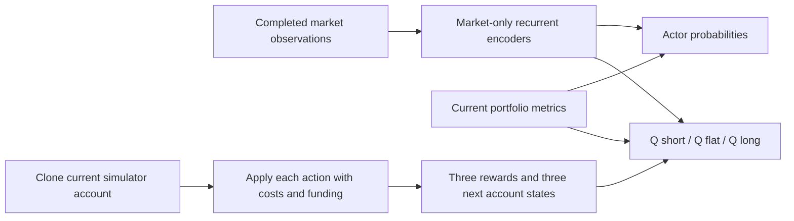

# Perpetual v4: completed-run investigation

The run completed successfully on 6 September 2026 at 17:08 Berlin time. Its
research outcome is unsuccessful: the deployed ensemble placed no orders in
any development year. The main observed failure is convergence toward flat
contracts under costly sampled exploration, followed by an ensemble that
reinforces that behavior. There is also a confirmed fast-encoder indexing defect.

This review examines all 20 training records, all 7,500 update records
(61,440,000 sampled decisions), all 120 individual validation checkpoint
summaries, the three ensemble validation reports, the 27 selected-checkpoint
round trips, and the saved development policies. It includes reproducible
checkpoint and simulator probes. No new model training was performed. No
2026 market data or test performance was accessed. Existing source and model
weights are unchanged.

## Results

| Validation year | Ensemble net BTC return | Orders | Time flat | Constant-long BTC return | Constant-short BTC return |
|---|---:|---:|---:|---:|---:|
| 2023 | 0.00% | 0 | 100% | +59.09% | −59.21% |
| 2024 | 0.00% | 0 | 100% | +47.49% | −47.61% |
| 2025 | 0.00% | 0 | 100% | −12.34% | +12.22% |

These are the saved base-cost, marked-equity development results. Constant-side
baselines enter once and keep fixed contract quantity, with funding and costs;
they are hindsight comparisons, not evidence that the agent could know the
winning direction beforehand. Changing ensemble costs from 6 to 8 or 10 bp per
leg made no difference because there were no orders.

The 300-update checkpoint won the specified selection rule: mean net log BTC
return across 15 individual fold/seed pairs. At that checkpoint:

| Individual policy | Net BTC return | Round trips | Maximum BTC drawdown |
|---|---:|---:|---:|
| 2024, seed 11 | +16.096% | 25 | −10.349% |
| 2024, seed 101 | +0.916% | 2 | −1.898% |
| Other 13 fold/seed pairs | 0.000% each | 0 | 0.000% |

All 27 trades were long positions. The selected median individual return was
zero and only 2/15 runs were positive. Across all scheduled checkpoints, 89/120
individual evaluations placed no orders. There were 37/40 inactive evaluations
in 2023, 17/40 in 2024 and 35/40 in 2025.

Seed 11's 2024 result contains a recognizable candidate behavior: buying after
sharp declines. Its median entry followed a 2.65% one-hour log-price decline,
at roughly the bottom 0.25% of that year's hourly-momentum observations. Median
hourly volatility at entry was around the 99.62nd percentile. There were 19
winning trades out of 25, over 17 distinct entry dates, with median holding time
50 minutes. The largest trade supplied 31.8% of aggregate trade log profit.
This supports a crash-rebound interpretation of that particular policy; it does
not establish a stable edge across years or seeds. Its 2024 return was positive
at all eight saved budgets, but the corresponding seed trained for the other
folds made no trades at the selected budget. [Trade records](selected_trades.csv),
[entry context](entry_context.json), [checkpoint results](validation_checkpoints.csv).

Five final policies were then trained on all pre-2026 data for 300 updates.
Their market performance is intentionally unknown: there is no final test
report. Their training logs repeat the flat-action collapse.

BTC collateral is essential to interpreting these numbers. A flat contract
account still owns BTC. Its USD returns in 2023, 2024 and 2025 were +156.09%,
+120.74% and −6.35%, respectively, purely from collateral appreciation or
depreciation. Those USD changes are not trading profits or market timing.

## 1. The training distribution collapsed before it taught position management

The following are means over development runs, except the last row, which is
the five final retraining runs:

| Update window | Sampled FLAT share | Policy entropy, nats | Non-flat action samples per 8,192-step rollout |
|---|---:|---:|---:|
| 1–5 | 33.99% | 1.09838 | 5,407.5 |
| 26–50 | 95.45% | 0.19426 | 372.4 |
| 76–100 | 99.46% | 0.02553 | 44.0 |
| 276–300 | 99.81% | 0.00213 | 15.5 |
| Final retraining, 276–300 | 99.989% | 0.000705 | 0.88 |

Non-flat samples count LONG/SHORT selections, including repeated holding
actions; they are not a count of independent entries. The development mean
late in training is kept above zero mainly by a small number of active policies.
For the last 25 updates of final retraining, 57.6% of whole 8,192-step rollouts
contained only FLAT selections.

Fourteen of fifteen development runs eventually exceeded 99% FLAT for ten
consecutive updates. The median first update of that condition was 65.5. The
exception was 2024 seed 11. The entropy coefficient reaches zero at update 201,
but collapse was already well advanced by update 100. Therefore the zero-entropy
endpoint is not the initial cause; increasing that endpoint alone is unlikely
to resolve the problem. [All update records](all_updates.csv), [summary](summary.json).

The causal mechanism is consistent with both the logs and a paired accounting
probe. The policy samples a fresh absolute target every five minutes. At
initially uniform independent probabilities, expected turnover is approximately
8/9 of account notional per decision, assuming fills are available and ignoring
small leverage/price changes. At 6 bp per leg, this is about 5.33 bp of cost per
decision. The observed first-five-update mean turnover was 0.883 and mean reward
was −0.05321, or approximately −5.32 bp of log wealth per decision.

I reconstructed the first rollout of 2023 seed 11 exactly, then replayed the
same actions and market path with commission and slippage disabled:

| Same 8,192 action samples | Mean reward, where reward = 100 × net log BTC change |
|---|---:|
| Original costs | −0.0526723 |
| No commission or slippage | +0.0011564 |
| Difference | −0.0538287 |

The original mean reproduces the saved log exactly. This establishes that costs
dominate this initial rollout's losses. It is not an ablation showing that a
cost-free trained policy would generalize or make money after restoring costs.

There is a sequence-learning problem as well. With uniform independent choices,
remaining in the same side for twelve consecutive five-minute decisions has
conditional probability (1/3)^11, about one in 177,147 after the initial entry.
That makes useful, sustained position-management examples scarce during early
exploration. Later, near-certain FLAT choices make entries themselves scarce.
Every random episode starts flat, and PPO discards old rollouts after updating,
so useful position histories have no replay mechanism that preserves them.

This is a strong explanation for the observed collapse, not a proof that a
profitable policy exists and the optimizer merely failed to find it. Flat can
be economically appropriate when available conditional returns do not cover
costs and risk. The objective should not be changed to reward trading activity.

## 2. A confirmed CNN defect discards the newest three minute bars

The local branch in [network.py](../../src/perpetual/network.py) is:

```text
60 bars → Conv1d(kernel=5, stride=2) → 28 locations
        → Conv1d(kernel=3, stride=2) → 13 locations
        → global average pooling
```

There is no padding. The second convolution's final location covers original
input indices 48 through 56. Original indices 57, 58 and 59 never reach the
output. Those are the newest three completed minute bars.

I verified this in two ways: their input gradients are exactly zero, and adding
100 to every fast feature in those three bars changes the local encoder output
by exactly zero. The same structure is used for actor and critic.

The slow momentum and volatility features still contain information from the
latest close. Therefore the whole policy is not completely blind to the latest
three minutes; the defect specifically removes their detailed fast features.
Its contribution to the flat collapse has not been measured by retraining.
It is a real implementation defect that should be corrected regardless.

Global averaging introduces a second representational limitation. Each pooled
location sees only a nine-minute local pattern; pooling largely removes where
that pattern occurred within the hour. Moving the same isolated interior
pattern by 16 minutes changed the local representation by only 1.49e−8 in the
controlled probe. This representation is poorly suited to distinguishing
recent reversal structure from a similar pattern earlier in the window.
[Reproduction and numeric results](probes.json).

Use a causal encoder whose output explicitly includes the newest bar and
preserves recency: for example, a causal convolution with stride one and a
final-time representation, or a GRU over the minute window. A regression check
must demonstrate influence from every input bar, especially the final bar.
A larger network alone does not correct the indexing.

## 3. Portfolio inputs are wired correctly, but the actor largely ignores them

The new actor actually receives account state, and actor/critic weights and
optimizers are separate. The former position-independent architecture is gone.
Nevertheless, providing the inputs did not make the trained policy use them
for useful control.

At 128 evenly spaced development moments per fold, I reconstructed causal flat
histories and changed only the current portfolio to a freshly opened long or
short, with appropriate entry costs and previous action. All 15 policies chose
FLAT in all three conditions at those sampled moments. The critic's value often
changed materially, while actor probabilities barely changed. These samples
miss most of the rare 2024 trade events, so they do not establish global
position invariance; they demonstrate overwhelmingly flat behavior at ordinary
sampled states. [Portfolio probes](probes.json).

Current market features and all portfolio features pass through the same
recurrent bottleneck within each branch, and the head has no direct account
input. This can make current account information difficult to use once the
actor has settled into a nearly constant response. It also makes counterfactual
account replay cumbersome because recurrent state depends on past actions and
positions.

An architectural improvement worth testing is separate market-only recurrent
encoders for actor and critic, followed by an explicit concatenation of current
portfolio state into each decision/value head. Keep position age, P&L,
excursions, drawdown, fees, funding and exposure. If an additional position
memory is needed, add it based on an ablation rather than assuming a larger GRU
will help. This is a proposed improvement, not an empirically proven cure.

## 4. The critic metrics gave a misleading impression of success

Development mean pre-update explained variance improved from about −0.002
in updates 1–5 to 0.574 in updates 376–400, while target standard deviation
fell from about 1.01 to 0.034 in reward units. Reward and turnover were
simultaneously shrinking toward zero.

A particularly clear example is 2025 seed 47, update 363:

- All 8,192 actions were FLAT.
- Turnover and mean reward were both exactly zero.
- Pre-update explained variance was 0.98359; post-update was 0.98994.

Across the run, 2,030 rollouts had only FLAT actions, no turnover and zero
reward; 669 of those had pre-update explained variance above 0.8.
[Examples](critic_flat_examples.json).

The implementation measures explained variance against GAE-based bootstrapped
training targets, not independently realized trading profits. Such targets
contain structure from the critic's own predictions even on an all-zero-reward
rollout. A high explained variance in that setting cannot demonstrate useful
entry, exit or risk decisions. It also does not prove that the value function
is implemented incorrectly. GAE intentionally trades bias and variance through
value-function bootstrapping. [GAE paper](https://arxiv.org/abs/1506.02438).

The state-value critic learns V(s) under the current policy. Once the policy
stays flat, it receives almost no evidence about sustained long and short
outcomes. Increasing its learning rate or adding more critic epochs can improve
fit on that distribution without supplying missing action comparisons.

Log value accuracy separately for flat, long and short states, and for entry,
exit and holding decisions. Add held-out development checks against realized
finite-horizon discounted returns with an explicit terminal convention, plus
reward/target dispersion and mean bias. Most importantly, measure whether the
critic can rank alternative actions after costs.

## 5. Equal probability averaging guarantees inactivity in this cohort

This is not merely cancellation between successful long and short experts.
Most members already prefer FLAT with overwhelming probability.

For the full common-account development paths at the selected checkpoint,
mean ensemble FLAT probabilities were approximately 99.9960% in 2023,
99.9021% in 2024 and 99.9958% in 2025. The minimum across the entire 2024
path was still 61.37%, and no more than two members favored LONG simultaneously.
The other three were effectively certain to remain flat.

At 2024-01-03 12:20 UTC, seed 11 assigned 80.27% to LONG and 0.56% to FLAT.
The other four assigned approximately 99.99% to FLAT. Their average assigned
80.11% to FLAT and only 16.06% to LONG. The executed FLAT action is exactly
what this ensemble rule specifies. [Full probability probes](probes.json).

Different random seeds count as an ensemble, but they do not guarantee useful
behavioral diversity. Here they mostly reproduce the same failure mode. The
probability mixture has no mechanism that lets a rare useful response overcome
three near-certain inactive members. That conservatism can be desirable in a
validated ensemble, but this cohort has not established the prerequisite
individual behavior.

## 6. Selection and diagnostics allowed a failed research outcome to advance

The selector optimizes mean individual validation log return, whereas deployment
uses argmax of averaged probabilities. These are different objectives. The
selected mean log return of 0.01056 comes entirely from the two active 2024
policies; the deployed ensemble return is zero in every year.

The coordinator then unconditionally retrains all five seeds after ensemble
validation, even when every ensemble makes zero trades. The five final jobs
therefore proceeded despite an already unsuccessful development result. This
is a missing research acceptance check, not a test-lock failure. Future selection
must evaluate the actual deployed decision rule and stop before final retraining
when there is no evidence of the requested trading behavior and economic value.
The check should report failure, not force the policy to trade.

The initial synthetic check was useful but insufficient. It used strong,
persistent, observable synthetic trends and a different recipe from production:
16 versus 60 fast bars, hidden size 16 versus 64, actor learning rate 0.001
versus 0.0001, and gamma 0.98 versus about 0.9976. Passing it established that
the implementation could learn an easy artificial task with those settings;
it did not validate the production recipe or subtle signals near the cost
threshold. The strided-encoder defect also survived that easy task.

The implementation I launched corrected several earlier accounting and PPO
consistency issues, but I missed the newest-bar coverage defect and did not
build a sufficient acceptance check around the development results.

## What the evidence does not support

There was no process failure, liquidation, NaN, or recorded recurrent replay
mismatch. Both replay-error maxima were zero across all 7,500 updates. Actor
and critic have separate gradient clipping budgets, so the previous concern
about critic gradients suppressing actor updates through common clipping does
not apply here. KL stopping occurred on 72 updates. There were occasional
post-update KL overshoots (maximum 0.0809), so the stop is not a hard trust-region
guarantee, but the overwhelming pattern is diminishing activity and very small
updates, not a general optimizer explosion. PPO's clipped surrogate is not a
hard KL constraint. [PPO paper](https://arxiv.org/abs/1707.06347).

The 24-hour discount half-life and two-hour GAE-weight half-life are assumptions
to examine, not demonstrated causes of this failure. Recurrent training uses
128-decision gradient sequences and a 128-decision prefix refresh, both about
10 hours 40 minutes; this is not unrestricted long-term memory. Nevertheless,
the existing account summaries retain position age and excursions, and the
logs do not establish that limited memory caused the early flat collapse.
Burn-in is a recognized way to address recurrent state mismatch, with its own
tradeoffs. [Recurrent replay study](https://openreview.net/pdf?id=r1lyTjAqYX).

Trade-price marking, adverse intrabar liquidation checks and fixed slippage
remain simulator approximations. They limit interpretation of rare-event
strategies and should receive stress checks. There is no evidence here that
they explain why the majority of models never entered a position.

More years of minute rows do not automatically fix inadequate coverage of
account/action trajectories or establish a stable conditional trading edge.
A learned trading policy still has to learn something about expected future
net outcomes; describing that policy as trading logic does not remove this
statistical requirement.

## Recommended next research design

First make the existing failure independently diagnosable. Correct the encoder
in a new version, preserve v4 unchanged, and use the exact production network
and optimizer on synthetic suites with no signal, a known persistent signal,
weak signals near transaction costs, and changing regimes. The no-signal case
should permit flat as a correct answer. Verify actual influence of position
state and the newest bar after training, not only at random initialization.

Run a bounded PPO comparison to measure the effect of fixing the encoder and
maintaining useful exploration/position-state coverage. Avoid a flat penalty,
mandatory holding periods or a bonus for placing trades; those could manufacture
activity without economic value. If exploration schedules or cost curricula
are compared, all reported development performance must use the full specified
execution costs. Longer training of the current collapsed policies is not the
first experiment to run.

The stronger alternative is an action-value learner that uses the simulator's
ability to compare all three actions at the same historical time and account.
This directly addresses the missing counterfactual experience:



For each training state, simulate SHORT, FLAT and LONG with the same next market
path, but their own holdings, fees, funding and liquidation outcomes. Train an
action-conditioned critic using targets such as:

`y(a) = r(a) + gamma * (1 - terminal(a)) * sum_b pi_target(b | next_state(a)) * Q_target(next_state(a), b)`

Future observations appear in training targets and next states only, never in
the current actor's input. Use target networks and evaluate value bias and
uncertainty. Replay causally generated position states covering flat, long,
short, profitable and losing positions, with genuine entry costs and account
histories. The actor can sum its gradient over the three action values instead
of relying entirely on a single sampled action. Expected policy gradients
provides a principled basis for action summation, but does not guarantee the
learned critic is accurate or that a tradable edge exists.
[Expected policy gradients](https://arxiv.org/abs/1801.03326).

This would be a separate learning algorithm, not standard PPO with synthetic
actions inserted into its on-policy clipped objective. It relies on the
small-trader assumption that these candidate actions do not change the
historical market path. Account-specific next states must remain separate;
reusing one next portfolio for all three would be an implementation error.

Keep independent actor/critic optimizer and clipping budgets. Put portfolio
features directly into their respective heads after market recurrence. Consider
a separate value head per action so action rankings and entry/exit cost effects
can be checked explicitly. These changes improve the experiment's ability to
learn and diagnose alternatives; their benefit still requires validation.

Only form an ensemble after members show repeatable net behavior across
chronological development periods. Compare the actual ensemble policy against
its members and simple baselines. If diversity comes from block resampling or
other model variants, keep chronological training boundaries intact. Select on
that deployed rule's development results and keep 2026 locked until the
research acceptance criteria are met and test access is explicitly authorized.

## Reproducing this review

From `model/`, both commands write only into this review directory:

```bash
.venv/bin/python research/2026-09-06-v4-review/collect.py
PYTHONPATH=src .venv/bin/python research/2026-09-06-v4-review/probe.py
```

The probe verifies that the saved source hash matches the completed experiment,
loads only the development cache, and aborts if the common-account probabilities
do not reproduce the ensemble's flat decisions. The exact original source file
hashes are in [source_manifest.json](source_manifest.json). The original
[run status](../../results/perpetual_v4/status.json),
[development report](../../results/perpetual_v4/development_report.json), and
[test lock](../../results/perpetual_v4/TEST_LOCK.json) remain in place.
