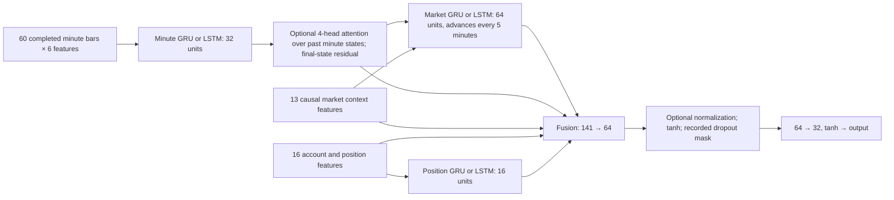

**V5: recurrent single-asset trading with controlled architecture comparisons**

This experiment addresses the user's request for seven-seed GRU/LSTM comparisons
with dropout, normalization and attention, plus learning changes directed at the
previous collapse to FLAT. It does not claim that a profitable general policy
has already been found. The 2026 test is locked throughout.

**Experiment matrix**

Each row is run with both GRU and LSTM, using identical input information,
hidden widths and training budgets. LSTM has more parameters at the same hidden
width; exact counts are recorded per run. The comparison is not claimed to be
an exact parameter-count match.

| Main arm | Normalization | Head dropout | Minute attention |
|---|---|---:|---|
| plain | none | 0 | no |
| dropout | none | 0.10 | no |
| layernorm | LayerNorm | 0 | no |
| batchnorm | Calibrated BatchNorm | 0 | no |
| attention | none | 0 | yes |
| layernorm_dropout | LayerNorm | 0.10 | no |
| layernorm_dropout_attention | LayerNorm | 0.10 | yes |
| batchnorm_dropout_attention | Calibrated BatchNorm | 0.10 | yes |

There are 16 main configurations. Two additional `layernorm_dropout_ppo_only`
controls, one per cell type, omit counterfactual rollouts and their losses while
retaining the same architecture, trainable continuation gate and training-start
distribution. These controls isolate alternative-action learning as a package.

Seeds: **11, 29, 47, 71, 101, 137, 179**. Every configuration uses all seven
seeds and all three development folds: train 2017–2022 / validate 2023;
train 2017–2023 / validate 2024; train 2017–2024 / validate 2025.
Total: **18 × 7 × 3 = 378 training runs**.

Each run has 400 updates and full-year validation at updates 100, 200, 300 and
400. The queue interleaves architectures before moving to the next year and
seed. Three workers with one PyTorch thread each run concurrently. The host has
eight logical CPUs, approximately 16 GB RAM, and no available CUDA device.

**Architecture**

The actor and critic have independent parameters and optimizers. Within each:

In the no-attention variants the minute recurrent final state goes directly
to the market recurrent input and fusion. All 60 minute observations reach the
encoder; the latest-minute defect and temporal average pooling are removed.
Market memory depends only on market observations. Current account state and
current market features reach the head directly. A separate position memory
retains the account path, including holding age, P&L and excursions.

The attention arm uses genuine multihead dot-product attention with a query
from the final minute recurrent state and keys/values from all 60 past states.
There is a residual from the final state. All attended bars precede the trading
decision. This is attention on a recurrent representation, not a full
Transformer replacement. It introduces no hidden LayerNorm into the
attention-only arm. Attention-weight dropout and built-in recurrent dropout
are disabled so their randomness cannot corrupt PPO replay.

The actor outputs a trainable probability of retaining the current side and
conditional probabilities of the alternative sides. These produce a normalized
three-action distribution over SHORT, FLAT and LONG. Its initial continuation
probability is 0.5 when flat and 0.9 when holding, through separately trainable
side-specific biases. These are disclosed exploration priors. All probabilities remain
trainable. There is no minimum holding period, fixed exit, stop-loss rule,
dip-buying threshold, trade bonus or penalty for being flat.

The critic outputs a state value V and three action values Q. The Q head is
trained on alternative-action returns and shares the critic representation;
the actor's auxiliary update uses the sampled counterfactual returns directly,
not the critic's predicted Q values. The Q head alone therefore is not claimed
to solve actor exploration.

**Why regularization is treated as an experiment**

Dropout can be useful, but changing its random mask when replaying a stored
action changes the evaluated policy even before any weight update. V5 samples
one mask for the actor head and one for the critic head per environment and
rollout, saves them and reuses them in all corresponding PPO and alternative
action computations. Masks affect the fusion head, not recurrent state
transitions. Evaluation uses the full network without dropout. This is an
explicitly recorded head-dropout experiment; it is not built-in recurrent
dropout at every time step. Recurrent regularization needs care about temporal
noise structure. [Gal and Ghahramani](https://arxiv.org/abs/1512.05287).

LayerNorm computes statistics per observation. It is a natural first comparison
for recurrent models because its computation does not depend on what other
trajectories share the minibatch. It is applied at the fusion layer, not claimed
to normalize internal GRU/LSTM gates. [Layer Normalization](https://arxiv.org/abs/1607.06450).

The BatchNorm arm is deliberately **calibrated BatchNorm**, not conventional
per-minibatch training BatchNorm. Initial moments are fitted to actual
training-only simulated account sequences including all three sides, costs
and funding. Running moments are then frozen during collection, PPO updates
and evaluation, while affine parameters are learned. This prevents other
samples or future steps in a training batch from changing a decision's
normalization, and keeps collection/replay identical. Fixed moments may become
stale as representations change; its performance is an open question. The
original BatchNorm paper does not establish that BatchNorm and dropout are
both essential. [Batch Normalization](https://arxiv.org/abs/1502.03167).

Attention is tested as a way to access particular earlier minute states.
The fact that attention is successful elsewhere does not establish a BTC
trading edge. [Attention Is All You Need](https://arxiv.org/abs/1706.03762).

**Training experiences and objectives**

One-third of initial training histories are untouched flat accounts. The
remaining histories use a 128-decision historical warmup generated by a
persistent random action process. It repeats
the current side with probability 0.9 or samples one of the other two sides.
The ledger accounts for every fill, fee, funding payment, excursion and holding
minute. The resulting account/history is the starting state for the actual
training episode. This retains valid examples of open positions even if a
previous policy is nearly flat. Warmup actions are not inserted into PPO as
on-policy samples. They define a broader initial-state distribution. Validation
always starts with a flat contract position and 1 BTC.

During a rollout, four anchor decisions per environment are selected at fixed
offsets 64, 192, 320 and 448. At each anchor the full actual account and recurrent
history are copied. Three independent ledgers take SHORT, FLAT and LONG as
their first action. Each then follows the sampled current policy for a total
of 48 decisions (four hours), including that first action, and bootstraps the
remaining value. Every continuation fits within the training rollout's date
range. Common random numbers reduce comparison noise across the three paths.

With eight environments this supplies 32 anchor states, 96 alternative paths
and 4,608 additional simulated decisions per training update. These are
alternative account experiences on the same historical market, not new
independent market data. A small-agent/no-market-impact assumption is inherited
from the simulator. Copied-environment exploration is an existing idea in
[Théate and Ernst, section 4.2](https://arxiv.org/pdf/2004.06627).

The main actor loss is ordinary clipped PPO on the 4,096 actions actually
sampled in its rollout, using GAE. The additional actor loss is a separate,
enumerated action-return estimator:

`−mean_s sum_a π_old(a|s) min(ratio_a × A_cf, clipped_ratio_a × A_cf)`.

Here `A_cf` is the sampled alternative return minus its old-policy-weighted
baseline, normalized by one RMS scale for the anchor batch. It is not a
future-price feature and does not prescribe the best action as an oracle at
evaluation. It uses only training outcomes. The auxiliary actor weight is 0.5
and begins after ten warmup updates. Both ordinary and auxiliary updates check
the full categorical KL on their corresponding states against the same old
policy. This is **PPO plus a counterfactual policy-gradient objective**, not
unchanged PPO. The extra objective's practical value needs the PPO-only control.

The critic separately fits V to GAE-based targets and Q to the three simulated
returns. The Q regression has weight 0.5. No copied trajectory enters the main
GAE array or masquerades as a sampled PPO action. Counterfactual continuations
follow the current policy, so a policy that closes every counterfactual position
immediately can still make sustained alternatives difficult to learn. The
training starts and persistence prior address experience coverage; they are
not a proof that optimization will escape every poor solution.

**Key settings**

| Setting | V5 |
|---|---|
| Market / contract | Single XBTUSD inverse perpetual, BTC collateral |
| Decision / accounting interval | 5 minutes / 1 minute |
| Reward | 100 × net log BTC equity change |
| Entry leverage / initial account | 1× notional / 1 BTC before warmup or validation |
| Fee / slippage | 5 bp / 1 bp per execution leg |
| Discount γ / GAE λ | 0.9975961328836203 / 0.9738730024397007 |
| Actor / critic optimizer | Adam, 1e−4 / 3e−4, β=(0.9, 0.999), ε=1e−8, weight decay 0 |
| PPO clipping / target KL | 0.2 / 0.01; pre-step stop threshold 0.015 |
| Gradient norm cap | 0.5 separately for actor and critic |
| Entropy coefficient | Constant 0.005, never deliberately decayed to zero |
| Main rollout | 8 environments × 512 decisions = 4,096 transitions |
| Sequence / burn-in | 128 / 128 decisions |
| Minibatch | 8 sequences × 128 decisions = 1,024 transitions |
| Epochs | 4 actor/critic plus 2 extra critic epochs |
| Counterfactual horizon | 48 decisions, followed by value bootstrap |
| Counterfactual actor / critic weights | 0.5 / 0.5 |
| Episode length | 4,096 decisions after the exploratory prefix |
| Training budget | 400 updates, 1,638,400 sampled main decisions per run |
| Policy/full-year validation checkpoints | Updates 100, 200, 300, 400 |
| Resume checkpoint | Every 10 updates and after validation |

The fixed widths are minute 32, market 64, position 16, fusion 64 and final
hidden 32. Recurrent weights use orthogonal hidden gates and Xavier input
weights; LSTM uses a total forget-gate bias of one. Actor output gain is 0.01,
critic output gain 1.0. Market normalization is fitted only on the appropriate
training fold and clipped to [−8, 8]. All source/configuration values are
recorded in the frozen protocol.

**Checks, selection, and operation**

Unit/integration checks cover exact mask replay, deterministic checkpoint
resume, recurrent state and cached evaluation equivalence for GRU/LSTM,
independent counterfactual ledgers and real costs, all-minute influence,
direct account effects, BatchNorm batch independence, training-start histories,
and rejection of test dates before evaluator data access.

The synthetic check uses a deliberately strong alternating trend, the real
inverse-contract ledger and the production architecture/optimizer settings.
It diagnoses an ability to learn a supplied signal; it is not market
performance evidence. The real-data smoke tests explicitly check that the
combined LSTM/BatchNorm/dropout/attention model can update and validate without
replay errors, including after the auxiliary actor objective starts.

An initial prototype used a 0.9 continuation prior for every side and only
randomized position histories. It earned sampled rewards in the synthetic
task while its deterministic validation stayed flat through update 40.
This exposed an excessive initial barrier to entry and underrepresentation
of untouched flat histories. The side-specific initialization and explicit
flat-start mixture address those issues. The prototype source and diagnostic
records are preserved in this directory; they are not production results.

Each architecture's common checkpoint budget is selected across its 21
seed/year validations by median net log return, then mean net log return, then
earlier budget. The seven-member probability mixture is actually evaluated
on a single evolving account for each validation year. Reporting individual
seed returns alone does not establish ensemble behavior.

A provisional development-candidate flag requires positive median individual
log return, at least two-thirds positive seed/year results, no liquidations,
and positive ensemble log return in all three validation years. This is a
development screen, not statistical proof or authorization to deploy. An
all-flat architecture can be reported honestly but cannot receive that flag.
No final retraining or test evaluation is automatically launched at the end.

Training logs report entry, exit and reversal decisions; account-side
occupancy; holding age; turnover; conditional value errors; counterfactual
action comparisons; and replay/KL diagnostics. Return, drawdown and completed
trades determine useful behavior, not critic explained variance alone.

The service uses `model/scripts/run_perpetual_v5.sh`. Progress is available via
`model/.venv/bin/python model/scripts/perpetual_v5_status.py`, and in
`model/results/perpetual_v5/status.json`. Per-run logs and checkpoints are in
the new v5 directory. V4 source, data cache, results and the seed 11 evidence
are preserved. Source fingerprints prevent changed implementations from being
silently mixed into a running experiment. Resume restores model, both
optimizers, account histories and all sampling RNG states.

The test from 2026-01-01 onward remains locked. Reading the pre-2026 cache,
checking development cutoffs and whitelisting only validation years
2023/2024/2025 keep every scheduled job within the authorized development data.
